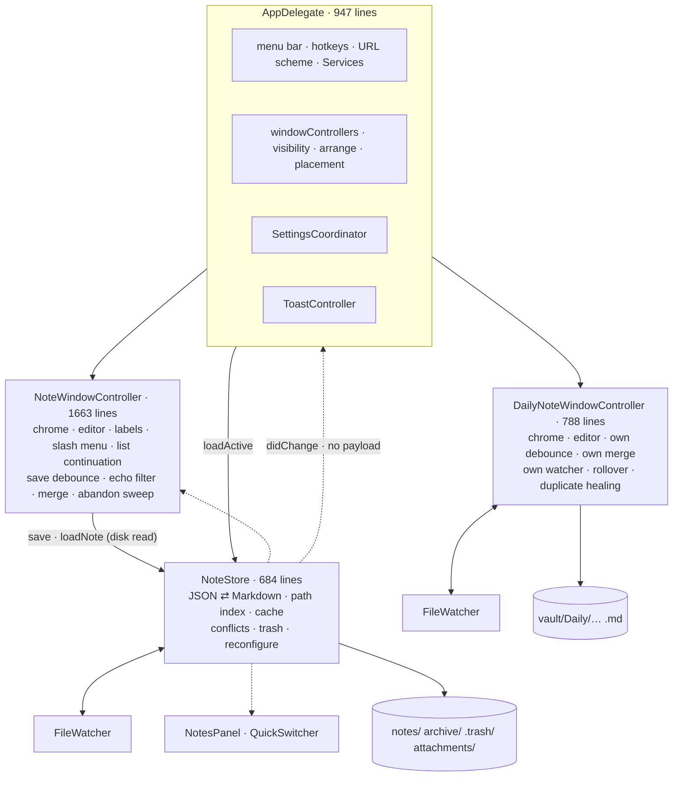
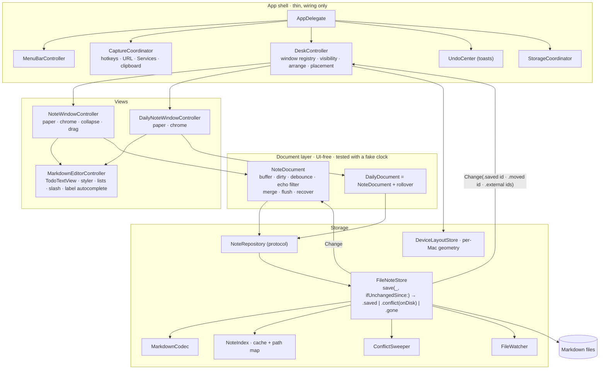

# Sticky Notes — Masterpiece Plan

Written against commit `cbbec66` (v0.9.0 + three data-safety commits). Line numbers refer to that tree.
PLAN.md, UX-PLAN.md and BUGFIX-PLAN.md are fully shipped; nothing here re-proposes them. Read their
"Deliberately not done" lists first — most of them stay not done, on purpose, and §8 says why.

## Conclusion

The feature set is complete and the UX is already better than Apple's Stickies. Three things stand
between this app and a masterpiece, in this order:

1. **The note lifecycle is implemented twice, inside two window controllers, and it still has
   write-write races.** `NoteWindowController` (1,663 lines) and `DailyNoteWindowController`
   (788 lines) each own a debounce, an echo filter and a merge; the daily one did not get the
   fix in `6cbd1f0`, and neither one checks the file before overwriting it, so an Obsidian edit
   that lands inside the half-second debounce is silently lost. Extract one UI-free
   `NoteDocument` state machine, give the store a compare-and-swap write, and the TLA+ model in
   `model/` has one thing to check instead of two.
2. **Window geometry is synced data.** `positionX/Y/width/height` live in the note's frontmatter
   (NoteStore.swift:605-608), so every drag rewrites the file, uploads it, and lands the note at
   the wrong place on a Mac with a different screen. Per-device layout is the single change that
   makes two-Mac use feel designed rather than tolerated.
3. **Reach.** Ad-hoc signing, no updater, `CFBundleVersion` fixed at `1`. A Developer ID,
   Sparkle and a Homebrew cask turn a personal tool into something a demanding Mac user can
   recommend without a paragraph of caveats.

One fix goes ahead of all of it: the "Conflicted copy" block that appears when typing into a new
note in a vault on iCloud Drive (1.0). The TLA+ model in `model/` reproduces it; the cause is a
merge rule that appends an older copy of the user's own text. It is a small hotfix and does not
wait for Phase 0.

After those: keyboard parity with the original Stickies (⌘1–⌘7 colours, ⌘M collapse, ⌘W close),
a title that scales with ⌘+, incremental restyling, and VoiceOver on the custom views. Then stop.

Phases 0–1 are foundations and must land first. Phases 2–4 are independent of each other.
Phase 5 (distribution) needs only Phase 0's build-number change and an owner decision.

## Ground rules for the implementer

1. Keep the constraints the earlier plans set: plain files, Obsidian-compatible Markdown, AppKit,
   SwiftPM, two dependencies plus (if D4 is approved) Sparkle. No SwiftUI rewrite.
2. One phase per branch. 474 tests stay green. Every lifecycle change in Phase 0–1 gets a test
   that drives the real `NoteDocument` with a fake clock, not a `waitForRunLoop(0.8)`
   (NoteWindowEndToEndTests.swift:56-61 is the pattern to retire).
3. Delete what a change makes redundant in the same PR. The refactors below remove more lines
   than they add; a PR that only adds is a smell.
4. No new preference without a sentence of justification in the commit. Items below that need a
   decision are marked **Decision Dn** and listed with defaults in §7.

---

## 1. Architecture: current and proposed

### Current

What this costs today: a keystroke pause in one note makes every open window read its own file
from disk twice (NoteStore.swift:147-151 bypasses the cache; the save and its watcher echo both
post `didChange`); a feature like "pin note" touches `Note`, `NoteStore.renderMarkdown`,
`NoteWindowController`, `AppDelegate.applyVisibility` and the panel cell; and the daily note
cannot be searched, arranged or hidden by label because it is not a note.

### Proposed

The test for the boundary: `NoteDocument`, `FileNoteStore`, `DeviceLayoutStore` and
`MarkdownEditorController` must each be constructible in a test without `NSApp`, without
`UserDefaults.standard`, and without a wall-clock wait.

---

## 2. Phase 0 — Foundations (do first)

### 0.1 Extract `NoteDocument`

**Problem.** The save/merge lifecycle lives in `NoteWindowController.swift:62-100, 1302-1401,
1612-1662` and again, differently, in `DailyNoteWindowController.swift:30-38, 336-461, 746-751`.
The daily copy still applies disk over an unsaved buffer whenever the window is not key
(DailyNoteWindowController.swift:353-361) — the exact bug `6cbd1f0` fixed for notes. Two
implementations guarantee this class of drift.

**Change.** One `final class NoteDocument` (UI-free) owning: `buffer` (title, body, labels),
`persisted` snapshot, `pendingExternal`, `dirty`, a `Scheduler` protocol for the debounce (real:
`DispatchQueue.main.asyncAfter`; test: manual tick), and the four transitions `edit`, `externalChange`,
`flush`, `close(.archive | .discard | .externalDeletion)`. It talks to `NoteRepository`, never to
AppKit. `NoteWindowController` and `DailyNoteWindowController` become observers that render
`document.buffer` and forward typing. `DailyDocument` adds `rolloverIfNeeded(now:)` and file
resolution; the midnight timer and wake observer move to `DeskController`.

**Why it matters.** Every data-loss bug in BUGFIX-PLAN §0 and R1–R6 lived in this code. One copy,
driven by a fake clock, is the only way the TLA+ model's findings become regression tests.

**Verify.** Port `NoteWindowEndToEndTests` and `DailyNoteWindowTests` to drive `NoteDocument` with
a `TestScheduler`; no `waitForRunLoop`. Add the race tests from §6. The two controllers lose
~500 lines between them.

**Size.** L.

### 0.2 Compare-and-swap writes and a change payload

**Problem.** `NoteStore.save` (NoteStore.swift:103-137) writes unconditionally and returns `Void`;
the controller records success before calling it (`persist`, NoteWindowController.swift:1634-1639).
`didChange` carries no payload (NoteStore.swift:342-344), so every observer reloads everything.

**Change.**
- `func save(_ note: Note, expecting fingerprint: Fingerprint?) -> SaveResult` where
  `Fingerprint` is the mtime+size (or content hash) the document last read, and `SaveResult` is
  `.saved(Fingerprint) | .conflict(onDisk: Note) | .gone | .failed(Error)`. `.conflict` is the
  `NoteDocument`'s cue to merge via `ConflictResolver` and retry once.
- `NoteStore.Change` enum posted as the notification object:
  `.saved(UUID) | .moved(UUID, from: Folder, to: Folder) | .external(Set<UUID>) | .reset`.
  `handleStoreChange` in the controller ignores `.saved(ownId)` without touching disk; the
  `DeskController` reconciles only on `.external`/`.moved`/`.reset`.
- `loadNote(id:)` serves from the cache (NoteStore.swift:147-151 currently reads the file).

**Why it matters.** Closes R1, R2, R5 (§6). Zero disk reads per keystroke with 40 notes open
(today: 80).

**Verify.** Unit tests for each `SaveResult`; a test that saves with a stale fingerprint after an
external write and asserts `.conflict` with the external body intact; a counter on `read(_:)` in
tests asserting 0 reads for a `.saved(other)` notification.

**Size.** M.

### 0.3 Inject the store, the settings and the clock

**Problem.** `AppDelegate` builds `NoteStore()` at property-init (AppDelegate.swift:8) against the
user's real storage, so it has zero tests and the comment at NoteWindowEndToEndTests.swift:13-16
says so. `Settings.shared` is `UserDefaults.standard` (Settings.swift:4-7); `Note.makeNew` reads
it (Note.swift:180); `DailyNote.resolvedURL` reads it (DailyNote.swift:109-112); tests save and
restore real defaults in `setUp`/`tearDown` (DailyNoteWindowTests.swift:28-46).

**Change.** `AppDelegate.init(store:settings:clock:)` with the production defaults in `main.swift`.
`Settings` becomes an instance over an injected `UserDefaults` (tests use `UserDefaults(suiteName:)`).
`Note.makeNew(frame:color:)` takes the colour. Dates come from a `Clock` protocol where a `Date()`
is compared against anything (trash purge, conflict divider, rollover).

**Why it matters.** Prerequisite for testing the shell at all, and for 0.4.

**Verify.** A test that constructs `AppDelegate` against a temp store and asserts
`applicationDidFinishLaunching` opens one window per active note.

**Size.** M.

### 0.4 Split `AppDelegate`

**Problem.** 947 lines, four jobs (AppDelegate.swift:146-332 menu, 334-453 hotkeys/visibility/
arrange, 515-676 capture and windows, 833-913 storage coordination), plus
`MainActor.assumeIsolated` to paper over the lack of actor annotations (:298-302).

**Change.** `MenuBarController`, `CaptureCoordinator` (hotkeys, URL scheme, Services, clipboard —
all route to `DeskController.makeNote`), `DeskController` (the `windowControllers` registry,
`applyVisibility`, arrange, placement, reconcile), `StorageCoordinator` (the `SettingsCoordinator`
conformance), `UndoCenter` (wraps `ToastController`). `AppDelegate` wires them and forwards
lifecycle. Mark every UI type `@MainActor`; build with `-strict-concurrency=complete` in CI.

**Why it matters.** The next ten features (pin, templates, App Intents, per-note options) each
touch one of these instead of all of them.

**Verify.** `swift build -Xswiftc -strict-concurrency=complete` clean; the 0.3 test still passes;
each new type has at least one direct test (visibility rules, capture routing, label-hide).

**Size.** M.

### 0.5 Extract `MarkdownEditorController`

**Problem.** The editor behaviours are split across `NoteWindowController.swift:815-1298`
(styling, list continuation, slash menus, label autocomplete, glyph hiding, checkbox toggle),
`DailyNoteWindowController.swift:755-787` (a second checkbox toggle with different bracket
logic), `MarkdownStyler.swift:622-658` (a second copy of the glyph-hiding layout delegate) and
`CheckboxAttachment.swift` (`TodoTextView`, ⌘B/I/E/↩).

**Change.** One `MarkdownEditorController` owning a `TodoTextView`, the layout-manager delegate,
restyle-on-change, list continuation, the body slash menu and label autocomplete; it exposes
`onTextChange`, `onLabelTyped`. Both window controllers host it. Delete the duplicate layout
delegate and the daily checkbox toggle.

**Why it matters.** The quick-switcher preview, the daily note and ordinary notes render Markdown
identically; a styler fix lands once.

**Verify.** Existing `MarkdownEditingTests`/`MarkdownStylerTests` unchanged; a new test that the
daily note and a note toggle a `- [ ]` on a tab-indented line identically.

**Size.** M.

### 0.6 One on-disk format — **Decision D1**

**Problem.** `StorageFormat` (NoteStore.swift:4-7) branches in `existingURL`, `generateURL`,
`read`, `writeOnce`, `purgeExpiredTrash` and the `fileExtension` check. "Local" and "iCloud Drive"
mean JSON; "vault" means Markdown. A local user who later points Obsidian at their notes cannot,
because the files are JSON.

**Change.** Markdown with frontmatter everywhere. First launch after upgrade migrates `*.json` in
`notes/`, `archive/` and `.trash/` to `.md` in place (keep the JSON files until the write
succeeds, then delete). Remove `StorageFormat` and the JSON codec; `Settings.preferredFormat`
goes away.

**Why it matters.** One codec, half the storage test matrix, and every user's notes are
Obsidian-openable by pointing a vault at the folder.

**Verify.** Migration test: a root with 50 JSON notes, one malformed, migrates 49 and reports one
`StorageFailure`; relaunch is idempotent.

**Size.** M. Default: do it.

### 0.7 Build number and version plumbing

**Problem.** `CFBundleVersion` is `1` forever (Resources/Info.plist); Sparkle and the App Store
both compare build numbers. `appVersionString` falls back to "dev" (AppDelegate.swift:288-296).

**Change.** `build-app.sh` stamps `CFBundleVersion` with `git rev-list --count HEAD`. S.

---

## 3. Phase 1 — Trust: no keystroke is ever lost

Each item cites the risk ID from §6 and, where the model checked it, the finding ID (F1–F10) from
`model/REPORT.md`. 0.1 and 0.2 are prerequisites, except for 1.0, which lands first on the
current code.

### 1.0 Hotfix: no "Conflicted copy" of your own text (F1, F2; owner's field bug)

**Problem.** Typing a few lines into a new note in a vault on iCloud Drive often appends a
"Conflicted copy" block. `ConflictResolver.merge` (ConflictResolver.swift:25-31) appends any
losing version whose body is not a substring of the winner, so an older copy of the user's own
text qualifies after one backspace or mid-line edit. Three paths feed it such a copy (model
configs `owner-h1`, `owner-obsidian`, `owner-h2-prefilled`): iCloud keeping an older save of this
Mac as an `NSFileVersion` conflict, which `resolveConflict` (NoteStore.swift:470-501) merges
without asking which computer saved it; Obsidian writing back an older copy; and the creation echo
of a note created with text. Separately, `applyExternalNote` never updates `lastPersisted*`
(NoteWindowController.swift:1373-1403), so after one outside edit every later one is held back
and later merged as a conflict (F2).

**Change.**
- `ConflictResolver.merge`: compare by lines. Drop a losing version whose non-empty lines all
  occur in the winner; take the losing version when it contains the winner; append a block only
  when each side has lines the other lacks.
- `resolveConflict`: skip conflict versions saved by this computer
  (`localizedNameOfSavingComputer`) that are older than the current file. Do not mark a version
  resolved when `read` returned nil (NoteStore.swift:476-485).
- `applyExternalNote`: set `lastPersistedContent` / `lastPersistedTitle` to the adopted note.

**Verify.** Tests `testAnOlderVersionFromThisMacIsNotAppendedAsAConflict`,
`testAConflictVersionWithNothingNewLeavesTheNoteAlone`,
`testAnOutsideAppendWhileTheCaretIsInTheNoteIsTakenWithoutAConflictBlock`,
`testTwoVaultEditsInARowBothReachAnIdleWindow`. In the model, `ALLOW_ONE_SIDED_BLOCK = FALSE`
makes `NoSpuriousConflictBlock` hold. Before the fix, a temporary log of each conflict version's
saving computer and date on the owner's Mac shows whether iCloud self-conflicts are the source.

**Size.** S.

### 1.1 Never overwrite a file you have not read (R1, R5)

**Change.** `NoteDocument.flush` saves with the fingerprint from its last read; on `.conflict`, merge
with `ConflictResolver.merge([local, onDisk])`, apply the result to the buffer, save again with the
new fingerprint. The daily document does the same through the same path.

**Verify.** Test: external write between `edit` and the debounce firing; assert both texts on
disk and no "Conflicted copy" when the external text is a superset.

**Size.** S after 0.2.

### 1.2 A false "deleted" never discards typing (R3, R9, R10)

**Problem.** `reconcileOpenWindows` (AppDelegate.swift:118-129) closes any window whose id is
missing from `loadActive()`, and `loadAll` returns `[]` when the directory listing fails
(NoteStore.swift:506-508) and skips any file that fails to read (:511). An unreadable or
momentarily absent directory therefore closes every window and cancels every pending save
(`closeAfterExternalDeletion`, NoteWindowController.swift:1657-1662).

**Change.**
- `loadAll` distinguishes "listed and empty" from "could not list"; the latter becomes
  `.reset(unavailable)` and the desk does nothing.
- A note that vanished while its document is dirty writes the buffer to
  `.trash/recovered-<id>-<timestamp>.md` before closing, and shows the toast
  "Note disappeared — recovered copy in Trash".
- The notes panel archives through the desk (`DeskController.archive(id)` → the document's
  `close(.archive)`), not `store.archive` directly (NotesPanelController.swift:385-388), so the
  flush and the undo toast happen on that path too.

**Verify.** Tests: a dirty document whose file is removed externally leaves a recovered file;
`loadActive()` on an unreadable root reports unavailable and opens/closes no windows.

**Size.** M.

### 1.3 Write on first edit (R10)

**Problem.** `makeNote` saves an empty note immediately (AppDelegate.swift:557-562) and the blur
sweep deletes it (NoteWindowController.swift:741-750). In a synced vault every misfired hotkey is
a create + delete that the other Mac briefly opens as a window.

**Change.** `NoteDocument` for a new note starts `unsaved`; the first `edit` writes. Abandoning an
`unsaved` document touches no file. `closeNote`'s empty check (:538-546) and
`discardAbandonedCapture` (:93-100) collapse into `close(.discard)`.

**Verify.** Test: create, blur, assert no file ever existed; create, type one character, assert
file exists.

**Size.** S after 0.1.

### 1.4 Daily note parity (R4, R6, R7)

**Change.** Covered by 0.1 (`DailyDocument` inherits the defer-while-dirty rule). In addition: the
"Waiting for today's note to download…" placeholder (DailyNoteWindowController.swift:298-306)
makes the text view non-editable until the file is readable; at midnight a dirty buffer that
cannot be saved is written to `.trash/recovered-daily-<date>.md` rather than dropped (:514-523).

**Verify.** Tests under `DailyDocumentTests`: external edit while dirty and not key keeps both;
typing into the placeholder is impossible; rollover with an unsavable buffer leaves a recovered
file.

**Size.** S after 0.1.

### 1.5 Storage switch migrates everything (R12)

**Problem.** `reconfigure` (NoteStore.swift:284-311) copies active and archived notes, leaves
`.trash/` and `attachments/` behind, and overwrites whatever the destination already holds.
Attachment links are `../attachments/x.png` (Attachments.swift:20-23), so every pasted image
breaks after a switch.

**Change.** Migrate `.trash/` and `attachments/` too; if the destination already has notes,
merge by id (newest `updatedAt` wins, bodies through `ConflictResolver`) instead of overwriting;
report counts in a sheet. Stop the old watcher before copying.

**Verify.** Test: switch A→B→A with an archive on A in between; the archived note stays archived
and no attachment link dangles.

**Size.** M.

### 1.6 Conflict sweep off the launch path

**Problem.** `NoteStore.init` runs `resolveConflicts()` synchronously (NoteStore.swift:100),
asking `NSFileVersion` about every file before the first window appears.

**Change.** Run it after `restoreActiveNotes`, on a utility queue, posting `.external(ids)` for
anything it changed. Measure launch to first window with 500 notes; target < 300 ms.

**Size.** S.

### 1.7 Daily-note conflict versions are merged (F9)

**Problem.** Nothing reads `NSFileVersion` conflicts in the daily folder (DailyNote.swift and
DailyNoteWindowController.swift have no such call). When two Macs edit the same day's note within
the sync delay, one Mac's text survives only in a hidden conflict version.

**Change.** Run the store's conflict sweep (with the 1.0 merge rule) on today's file in
`reloadIfExternallyChanged` and `loadCurrentFile`. After 0.1 this is part of the shared document.

**Verify.** `testADailyNoteConflictVersionIsMergedIn`; model config `b-create-r3` holds.

**Size.** S.

### 1.8 Keep what Obsidian adds to the frontmatter

**Problem.** `renderMarkdown` writes a fixed key list (NoteStore.swift:598-616) and `Note` has no
place for unknown keys, so the next save drops properties Obsidian added (tags, aliases).
`parseLabelsList` reads only a flow-style `labels:` line (NoteStore.swift:651-661), so a list
Obsidian rewrites in block style parses as no labels and the labels are wiped. A title typed in
the first 0.35 s of an empty note can also be wiped by the creation echo
(NoteWindowController.swift:1359-1363).

**Change.** Carry unknown frontmatter keys through `Note` unchanged; parse both YAML list styles;
treat a title-only difference against the creation echo as local.

**Verify.** Round-trip test with `tags`, `aliases` and block-style `labels`;
`testATitleTypedInTheFirstMomentSurvivesTheCreationEcho`.

**Size.** S.

---

## 4. Phase 2 — Two Macs, one desk

### 2.1 Per-device geometry — **Decision D2**

**Problem.** `positionX`, `positionY`, `width`, `height` and `collapsed` are serialised into the
synced note file (NoteStore.swift:605-609; Note.swift:106-110). Every drag rewrites and
re-uploads the note; a note placed bottom-right on a 27" display lands off-screen on a MacBook
and is clamped to a corner; two Macs overwrite each other's layout on every sync. BUGFIX-PLAN
3.6 already moved the daily note's geometry per-machine for exactly this reason.

**Change.** `DeviceLayoutStore` at `~/Library/Application Support/StickyNotes/layout.json`:
`[UUID: Frame + collapsed + floatLevel]`. The note file keeps `width/height` as a hint for a Mac
that has never seen the note (first placement uses `NotePlacement.next` on that Mac) and drops
`positionX/positionY/collapsed`. `floatLevel` stays in the file (it is intent, not geometry).
A `Note` loses its geometry fields; the window controller reads them from the layout store.

**Why it matters.** Dragging a note no longer touches the vault; a note synced in appears where
*this* desk has room; collapsing on the laptop does not collapse it on the desktop.

**Verify.** Test: a save after a move leaves the note file's mtime unchanged; a note with no
layout entry gets a `NotePlacement` frame on the pointer's screen.

**Size.** M. Default: do it; keep reading the old keys for one release so existing files place
correctly on first launch.

### 2.2 Notes over full-screen apps — **Decision D6**

**Problem.** `NoteWindow.collectionBehavior` lacks `.fullScreenAuxiliary` (NoteWindow.swift:43), so
notes vanish when any app goes full screen; the quick switcher already has it
(QuickSwitcherController.swift:66).

**Change.** Add `.fullScreenAuxiliary` to floating-level notes (not to desktop-level ones).

**Size.** S. Default: yes.

### 2.3 The daily note is a note

**Problem.** It is not a `Note`, so it is absent from the quick switcher
(QuickSwitcherController.swift:119-124), the panel, Arrange, and `[[wiki link]]` resolution.

**Change.** After 0.1, `DeskController` registers the `DailyDocument` as a candidate titled
"Today" in the switcher and includes its window in Arrange and Hide All (it already respects
Hide All). No frontmatter is ever written to the daily file.

**Size.** S.

---

## 5. Phase 3 — Craft

### 3.1 A Note menu, and Stickies' keyboard parity

**Problem.** `grep keyEquivalent NoteWindowController.swift` finds nothing. Collapse, archive,
colour, float level and labels are mouse-only (NoteWindowController.swift:534-564, 574-635,
1435-1470). The original Stickies had ⌘1–⌘6 for colours, ⌘M for collapse and ⌥⌘F for float.

**Change.** Add a **Note** menu to `NSApp.mainMenu` (key equivalents route through the hidden menu
bar in an `LSUIElement` app): Archive ⌘W · Collapse/Expand ⌘M · Yellow…Gray ⌘1–⌘7 · Float on Top
⌥⌘F · Labels… ⌥⌘L · Find in Note ⌘F (`usesFindBar = true`) · Next/Previous Note ⌘` / ⇧⌘`.
Actions go to first responder; the key window's controller implements them. Remove the manual
`performKeyEquivalent` table in NoteWindow.swift:54-77 once the menu carries those items.

**Verify.** Test that each menu action on a `NoteWindowController` performs the same mutation as
the chrome button; manual: every action works with the mouse unplugged.

**Size.** M.

### 3.2 Title scales with text size

**Problem.** `titleExpandedFont` is a `static let` computed once from `baseFontSize`
(NoteWindowController.swift:50) and `applyAppearanceColors` never resets `titleField.font`, so
⌘+ grows the body and leaves the title at its launch size.

**Change.** Compute the title font on demand; reapply in `applyAppearanceColors`.

**Verify.** Snapshot at 11 pt and 18 pt. **Size.** S.

### 3.3 Incremental restyling

**Problem.** `MarkdownStyler.apply` resets and restyles the whole storage on every keystroke
(MarkdownStyler.swift:78-109); BUGFIX-PLAN 3.12 measured 133 ms per keystroke at 50 KB after the
quadratic fix. Regexes are compiled per call (:116, :193-198) and `NSDataDetector` runs over the
whole document (:146).

**Change.** Everything the styler draws — ATX headings, list markers, checkboxes, inline
emphasis/code/strike/links, bare URLs, wiki links — is contained within one paragraph (text
between blank lines). On edit, restyle only the paragraphs intersecting the changed range plus
one on each side; parse that slice with `Document(parsing:)` and offset the ranges. Full restyle
remains for load, appearance change and text-size change. Cache the regexes as statics.

**Why it matters.** Typing in a long imported vault note should feel like TextEdit.

**Verify.** Extend `testStylingALargeNoteStaysFast`: a single-character edit in a 50 KB note
restyles in < 5 ms; a full restyle still produces byte-identical attributes to the incremental
path over a corpus of 200 generated notes.

**Size.** M.

### 3.4 Panel and switcher idle cost

**Problem.** `NotesPanelController.reload()` runs on every `didChange` even while the panel is
hidden (NotesPanelController.swift:78-82), rebuilding the label menu and re-ranking.

**Change.** Reload on `.external`/`.moved`/`.reset`, and on `.saved` only when the window is
visible; otherwise mark stale and reload on `showWindow`. **Size.** S.

### 3.5 Motion

**Problem.** A new note pops in; archiving closes the window abruptly (`window?.close()`,
NoteWindowController.swift:562). Collapse and snap are already animated.

**Change.** New note: 120 ms fade + 2 % scale from the anchor; archive: 120 ms fade toward the
menu-bar icon, then close. Both instant under Reduce Motion (`Appearance.animationDuration`).
Nothing else moves. **Size.** S.

### 3.6 Accessibility of the custom views

**Problem.** `LabelChipView` (LabelViews.swift:7-55), `CenteredTitleLabel` (NoteChrome.swift:42-76,
`hitTest` returns nil), `NoteDragZone` and `ResizeGripView` expose nothing to VoiceOver; a single
click on a chip removes the label with no undo (LabelViews.swift:47-50).

**Change.** Chips become `NSButton`s with `setAccessibilityLabel("#work, remove")`; removal goes
through the undo toast ("Removed #work — Undo"). The collapsed title bar gets role `.button`,
label "<title>, collapsed note, click to expand". The drag zone gets role `.group` with a label.
The panel and switcher rows get `accessibilityLabel` = heading + detail.

**Verify.** Accessibility Inspector audit of a note, the panel and the switcher: zero issues.
**Size.** S.

### 3.7 Welcome note that checks itself off

**Problem.** The welcome note's checklist (WelcomeNote.swift:56-68) is static; the user does the
thing and nothing acknowledges it.

**Change.** Store the welcome note's id in defaults; on the first ⌘⇧S, ⌘⇧F, label-hide and
collapse, flip the matching `- [ ]` via `MarkdownEditing.toggleCheckbox` and save. Remove the hook
once all four are checked. **Size.** S.

### 3.8 Small removals in the same pass

- `/` in the title field pops a date menu (NoteWindowController.swift:1085-1155). Remove; the body
  slash menu stays.
- `QuickSwitcherController.Selection` is unused (QuickSwitcherController.swift:21-25). Remove.
- `NSColor.note(_:)` is unused (Appearance.swift:70-74). Remove.
- "New Label…" opens a modal `NSAlert` (NoteWindowController.swift:1481-1496). Remove; typing `#`
  is the way.
- The settings recorder rows add a `didBecomeKeyNotification` observer for every window and never
  remove it (SettingsWindowController.swift:291-295). Observe the recorder's own window; remove in
  `deinit`.

---

## 6. Lifecycle and race risks for the `model/` work

Suspected, from reading. Each row names the state the model should reach and the property it
breaks. "Lost" means text that existed in a buffer or on disk and is in neither afterwards.

| ID | Risk | Where | Property to check |
|----|------|-------|-------------------|
| R1 | External write lands inside the save debounce; our save overwrites it; the watcher echo matches `lastPersistedContent` and is ignored. No conflict copy is produced because it is a plain overwrite on one machine. | NoteWindowController.swift:1612-1639 (`scheduleSave`/`persist`), NoteStore.swift:103-137 (`save` writes blind), FileWatcher.swift:15,67-78 (0.25 s debounce) | `∀ write by Obsidian: ◇ (text ∈ file ∨ text ∈ buffer)` |
| R2 | `persist` records success before `store.save` runs; `save` returns silently on the no-resurrect guard or a failed write. `hasUnsavedEdits` becomes false; the next external change is applied over the buffer. | NoteWindowController.swift:1634-1639, 1337-1342, 1317-1332; NoteStore.swift:104-123, 128 | `lastPersisted = buffer ⇒ file = buffer` |
| R3 | Directory listing fails or a file is unreadable (mid-sync, dataless, external drive); `loadActive` omits it; reconcile closes the window and cancels the pending save. | NoteStore.swift:506-508, 511; AppDelegate.swift:118-129; NoteWindowController.swift:1657-1662 | Buffer text with `dirty = true` is never dropped without a file written somewhere |
| R4 | Daily note applies disk over a dirty buffer when the window is not key (user grabbed the title bar). | DailyNoteWindowController.swift:336-362 | Same as R3 |
| R5 | Daily `saveNow` writes blind; an Obsidian edit between our last read and our write is overwritten and never seen (watcher sees `body == lastLoadedContent`). | DailyNoteWindowController.swift:441-461 | Same as R1 |
| R6 | Placeholder "Waiting for today's note…" is editable; `fileUnavailable` suppresses saves; the 5 s retry replaces the buffer. | DailyNoteWindowController.swift:298-306, 345-349, 409-418 | Typed text is never discarded by a reload |
| R7 | Midnight with `fileUnavailable = true`: `saveNow` returns, `loadCurrentFile` replaces yesterday's dirty buffer. | DailyNoteWindowController.swift:514-523, 442 | Same as R3 |
| R8 | Two Macs heal the same `<name> 2.md` concurrently (both watchers, both rate limits); one trashes a file the other is merging from; `mergeBodies` containment check may or may not dedupe. | DailyNote.swift:190-231; DailyNoteWindowController.swift:471-481 | Union of both bodies survives; merge is idempotent across machines |
| R9 | Panel archives via `store.archive` while the window has a pending save; the save hits the no-resurrect guard and is dropped; no undo toast. | NotesPanelController.swift:385-388; NoteStore.swift:104-123; AppDelegate.swift:125-129 | Archive from any surface flushes first |
| R10 | Empty note is written at creation and deleted on blur; on a synced vault the other Mac opens a window for it; if a user types there before the delete syncs, that window is closed by reconcile with its save cancelled. | AppDelegate.swift:557-562; NoteWindowController.swift:741-750, 93-100 | No empty note is ever on disk; a delete never closes a dirty window without a recovered file |
| R11 | Conflict-sweep write to a file whose window is dirty arrives as `.external`, is deferred, then merged on the next save. Check the merge order and that the sweep's `updatedAt = now` cannot make the user's live text the "loser". | NoteStore.swift:470-501; ConflictResolver.swift:15-40; NoteWindowController.swift:1347-1371 | Local buffer text leads the merged body |
| R12 | Storage switch A→B→A: `reconfigure` rewrites the destination from the current set without deleting, so a note archived while on B is active again on A; `.trash/` and `attachments/` are not migrated. | NoteStore.swift:284-311 | Archive/trash state is monotone across switches; attachment links resolve |
| R13 | `pendingExternalNote` holds only the latest external version; two externals before the user blurs → the first is replaced. Fine if the second supersedes the first; lossy if Obsidian wrote A then reverted to a subset. | NoteWindowController.swift:1317-1320 | Define: is "latest external wins among externals" acceptable? |
| R14 | Watcher coalescing: `invalidateCache` drops `confirmedDeletedIds` on every change, so a genuinely deleted note that keeps receiving saves rescans the directory once per external event. Not loss, but a liveness/cost property. | NoteStore.swift:335-340, 114-123 | Bounded rescans per deleted note |
| R15 | Rollover while dirty and key: `handleMidnight` → `saveNow` merges `pendingExternalContent` and writes to yesterday, then loads today. If the write fails (disk full), the buffer is replaced. | DailyNoteWindowController.swift:514-523, 455-460 | Same as R3 |

**Model verdicts** (`model/REPORT.md` §5; each confirmed by replaying the trace against the code):

| ID | Verdict | Finding |
|----|---------|---------|
| R1 | Reachable, confirmed | F4 |
| R2 | Reachable, confirmed | F6 |
| R3 | Reachable, confirmed | F5 |
| R4 | Reachable, confirmed | F7 |
| R5 | Reachable, confirmed | F8 |
| R6 | Reachable, confirmed | F10 |
| R7 | Same root as R6 | F10 |
| R8 | Not reachable as text loss: `mergeBodies` containment makes a second heal a no-op | — |
| R9 | Reachable, confirmed | F5 |
| R10 | Reachable, confirmed | F3 |
| R11 | No text loss; reachable as a nested Conflicted-copy block | F1 |
| R12 | Outside the model | — |
| R13 | Not a loss the app causes; "latest outside version wins" is the right rule | — |
| R14 | Outside the model | — |
| R15 | Confirmed in code, not modelled | same shape as F6 |

The model also found two risks this table missed: F1 (the merge appends text the winner already
has — the owner's field bug, item 1.0) and F9 (daily-note conflict versions are never merged,
item 1.7). F2 (an idle window stops following outside edits) is fixed in 1.0. Each fixed bug from
BUGFIX-PLAN, 6cbd1f0 and cbbec66 has a `regress-*.cfg` that breaks when its `ALLOW_OLD_*` switch
brings the old code back.

Items 1.0–1.8 are the fixes; the model should be re-run against the `NoteDocument` state machine
after 0.1, where `edit / externalChange / flush / close / fileGone / midnight` are the only
transitions.

---

## 7. Phase 5 — Distribution and reach

### 5.1 Developer ID and notarization — **Decision D3**

**Problem.** Ad-hoc signing; README tells users to right-click → Open. Every would-be user pays
that tax, and Sparkle cannot update an unsigned app safely.

**Change.** Developer ID Application certificate; `build-app.sh` already supports
`SIGN_IDENTITY`/`NOTARY_PROFILE`. Move signing into CI: a `release.yml` on tag push with the
`.p12` and notary API key as GitHub secrets, so a release does not depend on one Mac.

**Size.** S (plus US$99/yr). Default: yes — nothing else in this phase is possible without it.

### 5.2 Updates with Sparkle 2 — **Decision D4**

**Change.** Add `sparkle-project/Sparkle` via SwiftPM; EdDSA key in Keychain; `release.sh` runs
`generate_appcast` and publishes `appcast.xml` to GitHub Pages. Check on launch, at most daily;
"Check for Updates…" in the menu bar. Rejected alternative: a hand-rolled check against the
GitHub Releases API — no signatures, no delta, no UI, and a self-written binary replacer is the
one component not to write yourself. Sparkle is the exception to "two dependencies".

**Size.** M. Default: yes.

### 5.3 Homebrew cask and a one-page site

**Change.** After 5.1: `brew install --cask sticky-notes` (cask token depends on D5). A single
GitHub Pages page: a 15-second screen recording of ⌘⇧S → type → ⌘⇧F → find, three sentences,
Download and `brew` lines, link to the repo. No analytics, no newsletter.

**Size.** S.

### 5.4 Name — **Decision D5**

"Sticky Notes" is Microsoft's app name and one letter from Apple's. The bundle id
(`com.ronica.stickynotes`), the URL scheme, the cask token and the Sparkle feed are all forever
once notarized builds ship. Default: decide the name before 5.1 ships; no technical recommendation
on what it should be.

### 5.5 Not now: App Store, iOS — **Decisions D7, D8**

- **App Store: no.** Sandboxing moves iCloud storage into the app's ubiquity container (not
  `~/Library/Mobile Documents/com~apple~CloudDocs/StickyNotes`), forcing a migration for every
  iCloud user, and puts a review cycle in front of each data-safety fix. Revisit at 1.0 if direct
  distribution shows demand.
- **iOS companion: no.** The product is the desk. Vault users already have Obsidian mobile; a
  phone app that reads iCloud Drive files is a second product with its own sync story. Revisit
  only with a CloudKit design, which is not this plan.

---

## 8. What to remove or refuse

Removed in this plan: JSON format and the local/iCloud/vault three-way (D1 — one format, two
locations), geometry in frontmatter (D2), title slash menu, "New Label…" alert, dead `Selection`
and `NSColor.note`, the duplicate layout delegate and checkbox toggle, the manual
`performKeyEquivalent` table, the leaked settings observers.

Refused, with the reason to give when asked:

- **Inline image rendering.** The buffer is the file; an attachment character breaks that
  invariant and the save path. ⌘-click opens the image; that stays.
- **Reminders, templates, note graph, AI assist.** Each is a product of its own. Templates exist
  for the daily note because Obsidian defines them; nowhere else.
- **Rich text, custom fonts, themes.** Seven papers, SF, one size. Text size is the only
  preference, and it has an OS convention.
- **Sounds, onboarding tours, a Dock icon, a notification-centre widget.**
- **Exposé-style overview.** UX-PLAN parked it; Arrange plus the switcher's preview cover the need.
- **Our own sync service.** iCloud Drive and the vault are the sync; the app's job is to merge,
  never to lose.
- **Shortcuts (App Intents).** The URL scheme already drives Shortcuts, Raycast and Alfred.
  Reconsider only if a user asks for typed parameters.
- **Spotlight indexing.** Vault notes are already indexed as Markdown; Application Support is
  excluded by design.

---

## 9. Decisions for the owner

| # | Decision | Default | Needed by |
|---|----------|---------|-----------|
| D1 | Markdown as the only on-disk format; migrate JSON on first launch | Yes | 0.6 |
| D2 | Window geometry per device, out of the synced file | Yes, with one release of fallback reads | 2.1 |
| D3 | Apple Developer Program (US$99/yr) for Developer ID + notarization | Yes | 5.1 |
| D4 | Sparkle 2 as a third dependency | Yes | 5.2 |
| D5 | App name before notarized releases (bundle id, scheme, cask token are permanent) | Decide before 5.1 | 5.1 |
| D6 | Floating notes visible over full-screen apps | Yes | 2.2 |
| D7 | Mac App Store | No, revisit at 1.0 | — |
| D8 | iOS companion | No | — |

Everything else is implementation and does not need an answer.

---

## 10. Sequencing and sizing

| Phase | Items | Size | Depends on |
|-------|-------|------|------------|
| 0 Foundations | 0.1 NoteDocument · 0.2 CAS + payload · 0.3 injection · 0.4 split AppDelegate · 0.5 editor controller · 0.6 one format · 0.7 build number | L | D1 for 0.6 |
| 1 Trust | 1.1–1.6 | M | Phase 0; §6 model results |
| 2 Two Macs | 2.1 per-device layout · 2.2 full-screen · 2.3 daily is a note | M | 0.1, D2, D6 |
| 3 Craft | 3.1 Note menu · 3.2 title font · 3.3 incremental styling · 3.4 idle cost · 3.5 motion · 3.6 a11y · 3.7 welcome · 3.8 removals | M | 0.4, 0.5 |
| 5 Distribution | 5.1 signing in CI · 5.2 Sparkle · 5.3 cask + site · 5.4 name | M | 0.7, D3, D4, D5 |

Phases 2, 3 and 5 can run in parallel once Phase 1 has merged. Measurements to record before and
after Phases 0–3, in a `PERF.md` table, all on the same machine: launch to first window with 500
notes; hotkey to caret in a new note; per-keystroke restyle at 2 KB and 50 KB; disk reads per
keystroke pause with 40 notes open; resident memory after an hour.

## Definition of done

Tests green with `-strict-concurrency=complete`; no new warnings; `NoteDocument`,
`FileNoteStore`, `DeviceLayoutStore` and `MarkdownEditorController` each constructible in a test
without `NSApp`, `UserDefaults.standard` or a wall-clock wait; snapshots attached for anything
visual; `PERF.md` updated; the `model/` spec re-run against the new transitions; README changed
only where user-visible behaviour changed.

## Caveats

This plan comes from reading the code, not running it; timings quoted are BUGFIX-PLAN's
measurements. R1–R15 are suspected paths, written so the model can confirm or refute them — R8
and R13 in particular depend on iCloud rename and ordering behaviour that should be observed on
two real Macs before being treated as fact. Line numbers drift as soon as Phase 0 lands; the
identifiers in each citation are the stable reference.
