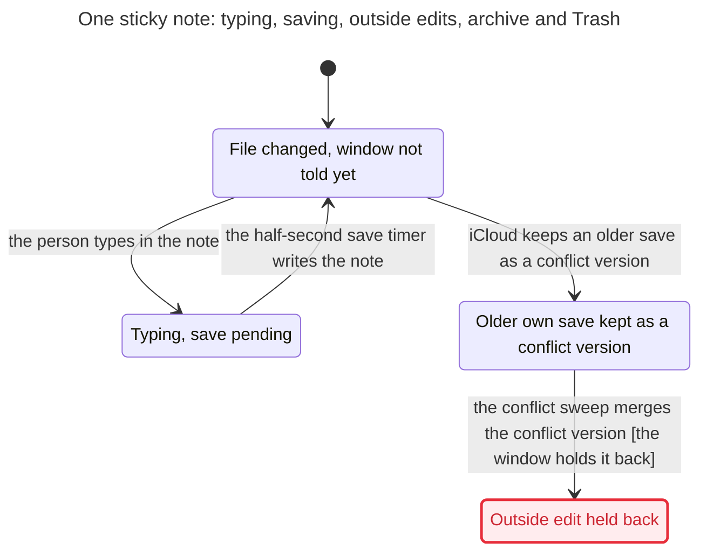
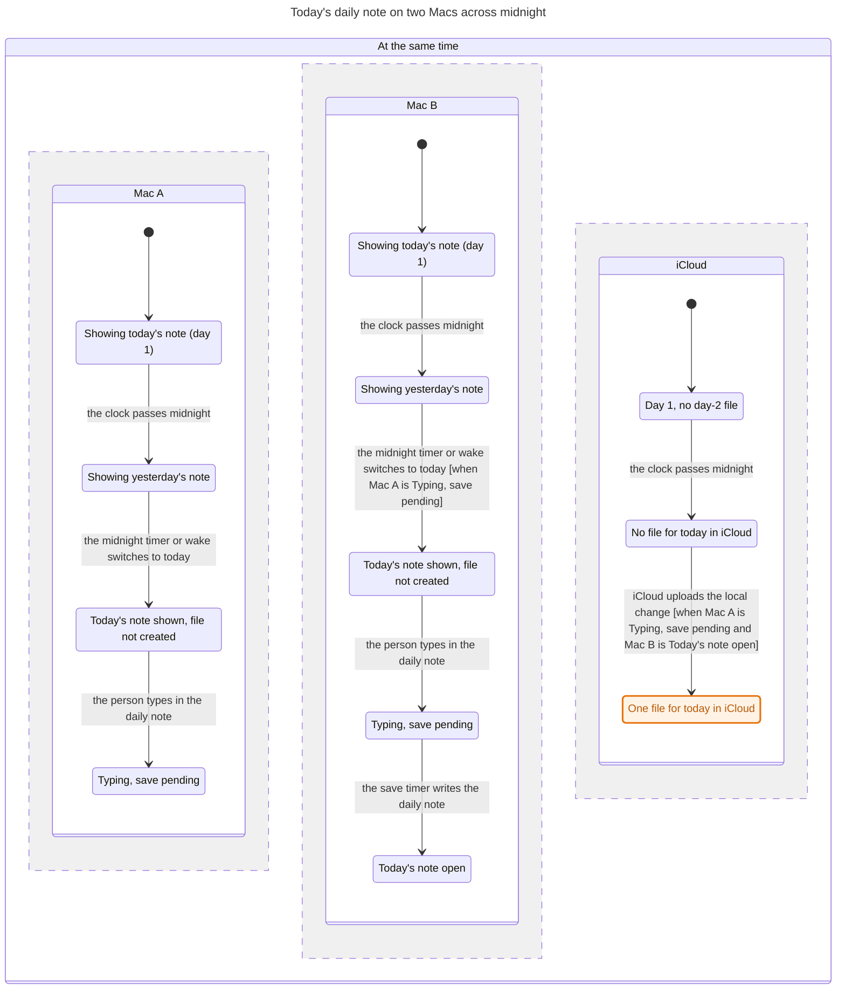

# Sticky Notes lifecycle and race model: report

Code checked: commit `cbbec66` (branch `masterpiece-plan`), Obsidian vault mode with the vault in iCloud Drive. Two TLA+ models, checked with TLC 2.19 through the statechart runner:
- **Model (a)** `NotePersistence.tla` covers one note: typing, the debounced save, the file watcher, outside edits, iCloud conflict versions, archive, Trash, purge and quit.
- **Model (b)** `DailyRollover.tla` covers today's daily note on two Macs across midnight, including which action creates the file.

Each config's output is in `out/<config>/report.md`. `NOTES.md` maps each action to file:line.

## 1. The owner's bug: "a Conflicted copy section appears when I type in a new note"

**Conclusion.** The model reproduces the bug. The root is one rule in `ConflictResolver.merge` (ConflictResolver.swift:25-31): it appends any losing version whose body is not a substring of the winner. It never checks whether that version holds any text the winner lacks. An older copy of your own text stops being a substring as soon as you press backspace or insert mid-line. So any path that feeds an older copy of this Mac's text back into a merge produces a "Conflicted copy" block.

On an empty new note with no other writer, no block appears (`owner-alone` holds over all 306 states). Three sources reach the bug:

| Source | Reachable in the model | In the code | Config |
| --- | --- | --- | --- |
| H1: iCloud keeps an older write of this Mac as a conflict version | yes, 6 steps | yes, if iCloud behaves this way | `owner-h1.cfg` |
| H2: the store's creation echo is taken for an outside edit | only for a note created with text (clipboard, Service, URL); **not** for an empty new note | yes | `owner-h2-prefilled.cfg`, `owner-alone.cfg` |
| Obsidian writes the file back from an older copy | yes, 7 steps | yes, if Obsidian behaves this way | `owner-obsidian.cfg` |

H1 is the likeliest cause for an empty new note. Obsidian is the second candidate, but only if the note is also open in Obsidian or a plugin rewrites it.

### H1: iCloud self-conflict (reachable)

Shortest path (`out/owner-h1/report.md`, 6 steps):
1. The person types `l1` (an append). `textDidChange` calls `scheduleSave` (NoteWindowController.swift:815-825, 1612-1627).
2. The save timer writes `l1`. `persist` calls `NoteStore.save`, then `write`: an atomic replace with no `NSFileCoordinator` (NoteWindowController.swift:1634-1639; NoteStore.swift:103-137, 539-566).
3. The person types `l2` with a backspace or a mid-line insert.
4. The save timer writes `l1+l2`.
5. iCloud keeps the step-2 file as an unresolved `NSFileVersion` conflict version.
6. `resolveConflictsIfDue` runs `resolveConflict` (NoteStore.swift:443-501).
   - The versions are [current file, older own write].
   - The winner is the newest `updatedAt`, which is the current file.
   - The older body is not a substring of the winner, so `merge` appends it under "Conflicted copy" and the file is rewritten.

**Follow-on: the block can nest.**
1. The sweep posts `didChange` synchronously (NoteStore.swift:463).
2. With the person still in the note, `handleStoreChange` holds the merged file back. The trace ends in "Outside edit held back".
3. The next save or blur merges the buffer with the merged file. The buffer wins because it is newest.
4. The merged file holds a divider the buffer lacks, so it is appended again.

**Confirmation.**
- The code side is confirmed by reading the lines above. `resolveConflict` never checks `NSFileVersion.localizedNameOfSavingComputer`, and never checks whether a version is older than our last write.
- The iCloud side cannot be proved by the model: whether the daemon makes conflict versions from one Mac's uncoordinated saves.
- Probe on the owner's Mac: temporarily log each conflict version's `localizedNameOfSavingComputer`, `modificationDate` and body length in `resolveConflict`, before the merge. If the saving computer is this Mac and the date is older than the current file, H1 is the cause.

### H2: creation echo (not reachable for an empty note)

Why an empty note is safe:
1. `makeNote` writes the new note through `noteStore.save` (AppDelegate.swift:562), not `persist()`, so `lastPersistedContent` is nil.
2. The watcher echo of that write therefore passes the echo check (NoteWindowController.swift:1306).
3. With a save armed, the echo is held back (1317-1320).
4. The held-back body is empty, and `merge` skips empty bodies (ConflictResolver.swift:27). No block appears.

Reachable for a note created with text (`owner-h2-prefilled`, 3 steps):
1. The person makes a non-append edit to the captured text within about 0.35 s. That is FSEvents latency of 0.1 s plus the watcher's 0.25 s debounce.
2. The echo of the creating write is held back.
3. The person switches away, and the stale captured text is appended as a conflict.

The Markdown round trip is not a cause. `MarkdownFile.serialize` and `parse` return the body and the title unchanged.

**Related, not modelled (titles are not in the model), confirmed by reading the code.** H2 also has a title variant that loses data instead of adding a block:
1. The person types a title within about 0.35 s of creating an empty note.
2. The person presses Return into the body and pauses for 0.5 s.
3. At merge time both bodies are empty, so `needsMerge` is false, and `titleField.currentEditor()` is nil.
4. `mergePendingExternalNote` applies the empty creation echo (NoteWindowController.swift:1359-1363). The typed title is wiped, then saved.

Test: `testATitleTypedInTheFirstMomentSurvivesTheCreationEcho`.

### Obsidian rewriting from an older copy (reachable)

`owner-obsidian`, 7 steps:
1. Two saves; the second contains a non-append edit.
2. Obsidian writes the file back from its older copy.
3. The person is in the note, so the window holds the change back.
4. The person switches away, and the merge adds the block.

A frontmatter-only rewrite by Obsidian does not add a block, because the echo check ignores it. It loses other data (found by reading the code, not modelled):
- `renderMarkdown` writes a fixed list of keys (NoteStore.swift:598-616), and `Note` has nowhere to keep unknown keys. Our next save therefore drops every property Obsidian added, such as tags and aliases.
- `parseLabelsList` reads only the `labels:` line (NoteStore.swift:651-661). A labels list rewritten in YAML block style therefore parses as no labels, and the labels are wiped.

### Fix for the owner's bug

- **`ConflictResolver.merge`:** compare by lines, not by substring.
  - Drop a losing version whose every non-empty line already occurs in the winner.
  - When the losing version contains the winner, take the losing version (`mergeBodies` already does this).
  - Append a block only when each side has lines the other lacks.
  - In the model this is `ALLOW_ONE_SIDED_BLOCK = FALSE`. With it, `NoSpuriousConflictBlock` holds in every later round.
- **`resolveConflict`:** skip conflict versions that this computer saved and that are older than the current file.
- **Writes:** go through `NSFileCoordinator` (or `NSFilePresenter`), so that iCloud sees saves in order.

Tests:
- `testAnOlderVersionFromThisMacIsNotAppendedAsAConflict`
- `testAConflictVersionWithNothingNewLeavesTheNoteAlone`
- `testAnOutsideAppendWhileTheCaretIsInTheNoteIsTakenWithoutAConflictBlock`

## 2. Rules and results

Each round sets one more `ALLOW_` constant to FALSE, one per broken rule per round, to show the next break. "Holds" means TLC explored every state.

### Model (a)

| Rule | Result | Configs |
| --- | --- | --- |
| `TypedTextKept`: no typed text is lost or silently overwritten | **broken**: four causes, F3-F6 | a-edits, a-conflicts, a-removal, plan-* |
| `NoSpuriousConflictBlock`: a Conflicted-copy block appears only when both sides have text the other lacks | **broken**: F1 | owner-h1, owner-h2-prefilled, owner-obsidian, a-edits, a-conflicts |
| `WindowMatchesDisk`: with nothing in flight and the person elsewhere, the window shows the file and holds no deferred edit | **broken**: F2, and F6 after a failed write | a-edits, a-conflicts, plan-r2-write-failure |
| `OneLifecycleState`: a note is never in two folders | holds everywhere | — |
| `PurgeRespectsRetention`: purge never removes a note deleted within 30 days | holds | a-lifecycle |
| NoDeadlock | holds everywhere | — |

NoDeadlock is a weak check here: quitting and relaunching is always possible, so the model never has a dead end. `WindowMatchesDisk` is the real check for a stuck state.

Peeling rounds (each concern ends with every rule holding):
- **Edits:** a-edits; then a-edits-r2 removes the empty-note discard, the one-sided block and the stale save mark; then a-edits-r3 removes the blind write. Holds, 14,073 states.
- **Conflicts:** a-conflicts; then -r2 removes the one-sided block; then -r3 makes the empty-note discard also check the file and its conflict versions. Holds, 9,032 states.
- **Removal:** a-removal; then -r2 sends a discard to the Trash; then -r3 keeps a save to a moved note; then -r4 makes reconcile keep the window's text. Holds, 20,731 states.
- **Lifecycle:** a-lifecycle holds as it is, 6,830 states.

### Model (b)

| Rule | Result | Configs |
| --- | --- | --- |
| `ClockNeverCreates`: the clock alone never creates the daily file | holds | b-create, b-midnight |
| `DuplicateOnlyFromTwoPeople`: a `<date> 2.md` appears only when people on both Macs created the file | holds | b-create |
| `DailyTextKept`: no typed text is lost, counting text kept only in an unread conflict version as lost | **broken**: F7-F10 | b-create, b-midnight |
| `RightDay`: text typed on one day never lands in another day's file | holds | b-create, b-midnight |

A duplicate file is reachable: the probe `ProbeNoDuplicateEver` breaks in 7 steps.

Peeling rounds:
- **Creation:** b-create (R4), then -r2 (R5), then -r3 (unmerged conflict), then -r4. Holds, 61,062 states.
- **Midnight:** b-midnight (R6), then -r2. Holds, 15,176 states.

## 3. Confirmed findings (open bugs)

"Confirmed" means each trace step was replayed by reading the code at the lines given. No tests were run, and Sources and Tests were not edited.

### F1: a merge appends text the winner already has

- **What happens:** the merge appends an older copy of our own text, or an outside version that only adds to ours. Example: the caret sits in the note, Obsidian appends a line, the person clicks away, and the whole note is duplicated under "Conflicted copy".
- **Rule and trace:** NoSpuriousConflictBlock. `a-edits`, 5 steps: type, save, outside append, the window holds it back, switch away.
- **Code:** ConflictResolver.swift:25-31. NoteWindowController.swift:1347-1371 stamps the buffer `updatedAt = now`, so the buffer always wins.
- **Severity: High.** The owner sees it. No text is lost, but notes fill with duplicates.
- **Fix and tests:** see §1.

### F2: an open note stops following outside edits

- **What happens:** after `applyExternalNote` shows an outside edit, `lastPersistedContent` is stale, so `hasUnsavedEdits` stays true. Every later outside edit to that idle note is held back instead of shown. The next click-away or keystroke then merges it as a conflict (F1). The window only has to have saved once this session: typing, moving or resizing it is enough.
- **Rule and trace:** WindowMatchesDisk. `a-edits`, 7 steps: type, switch away, save, outside edit shown, second outside change, held back while the person is elsewhere.
- **Code:** NoteWindowController.swift:1337-1342, 1373-1403 (`applyExternalNote` never sets `lastPersisted*`), 1306.
- **Severity: Medium-high.** The window stops following Obsidian after the second outside save.
- **Fix:** set `lastPersistedContent` and `lastPersistedTitle` to the shown note whenever the window adopts the file.
- **Test:** `testTwoVaultEditsInARowBothReachAnIdleWindow`.

### F3: discarding an "empty" note deletes text the window never showed

- **What happens:** the empty-note discard judges "empty" from the window only, then unlinks the file with no Trash. An outside edit or conflict version not yet shown is deleted with it. The other Mac's copy of the same code does the same (plan R10).
- **Rule and trace:** TypedTextKept. `a-edits`, 2 steps: an outside edit to a new empty note, then the person switches away.
- **Code:** NoteWindowController.swift:85-100, 538-546, 741-750; NoteStore.swift:161-168.
- **Severity: Medium-low.** The R10 two-Mac form is more likely.
- **Fix:** re-read the file and its conflict versions before discarding, and move the file to `.trash/` instead of deleting it.
- **Tests:** `testAnEmptyNoteWithTextOnDiskIsNotDiscarded`, `testDiscardingAnEmptyNoteGoesToTheTrash`.

### F4: a save overwrites an outside write the watcher has not reported yet (plan R1)

- **What happens:** a save writes without re-reading the file. An outside write the watcher has not reported yet (about 0.35 s) is overwritten. Its echo then matches `lastPersisted` and is ignored.
- **Rule and trace:** TypedTextKept. `a-edits-r2`: outside edit, close note.
- **Code:** NoteWindowController.swift:1634-1639; NoteStore.swift:103-137, 539-566; FileWatcher.swift:15, 49-50, 67-78.
- **Severity: Low-medium.**
- **Fix:** before writing, compare the file with `lastPersisted`, and merge it first if it differs.
- **Test:** `testASaveDoesNotOverwriteAVaultEditTheWatcherHasNotReported`.

### F5: a note that leaves the active folder loses the window's unsaved text

- **What happens:** three paths lose the text:
  - The no-resurrect guard in `store.save` skips the save.
  - Reconcile closes the window through `closeAfterExternalDeletion`.
  - The notes panel archives without flushing the window and shows no undo toast (plan R9).
- **Rule and trace:** TypedTextKept.
  - `a-removal-r2`: type, the other Mac archives, close note.
  - `a-removal-r3`: type, the other Mac archives, the watcher closes the window.
  - `plan-r9-panel`: type, switch to the panel, archive there, close note.
- **Code:** NoteStore.swift:103-124; AppDelegate.swift:118-129; NoteWindowController.swift:1657-1662; NotesPanelController.swift:385-388.
- **Severity: Low-medium.** R9 is the most likely path: Cmd-Backspace in the panel within 0.5 s of typing.
- **Fix:** route the panel's archive through the window's `closeNote`. Before reconcile closes a window, flush its text into the file wherever the file went.
- **Tests:** `testArchivingFromThePanelKeepsTextTypedJustBefore`, `testANoteArchivedElsewhereKeepsTheLastTyping`.

### F6: a failed write is treated as saved (plan R2)

- **What happens:** `persist` sets `lastPersisted` before `save` runs, and `closeNote` archives even after a failed write. The window then shows text that is on no disk, and nothing retries until the next edit.
- **Rule and trace:** TypedTextKept and WindowMatchesDisk. `plan-r2-write-failure`.
- **Code:** NoteWindowController.swift:538-563, 1634-1639; NoteStore.swift:128, 539-558.
- **Severity: Low.** Needs a full disk or a revoked permission.
- **Fix:** return the write result from `save`, mark persisted only on success, and do not archive or close after a failed write.
- **Test:** `testAFailedSaveKeepsTheNoteDirty`.

### F7: daily note, a reload discards unsaved typing (plan R4)

- **What happens:** reload applies the file over an armed save when the window is not key with the caret in it. This is the 6cbd1f0 bug, never fixed in the daily controller.
- **Rule and trace:** DailyTextKept. `b-create`, 12 steps: Mac A types today's first line and grabs the title bar; Mac B types, saves and syncs; Mac A's watcher applies Mac B's file.
- **Code:** DailyNoteWindowController.swift:353-361, 447.
- **Severity: Medium.**
- **Fix:** defer the reload when a save is armed or the buffer differs from `lastLoadedContent`, as NoteWindowController does.
- **Test:** `testADailyNoteChangeDoesNotDiscardUnsavedTyping`.

### F8: daily note, a save overwrites an unreported download (plan R5)

- **What happens:** `saveNow` writes without re-reading the file, so an iCloud download the watcher has not reported is overwritten.
- **Rule and trace:** DailyTextKept. `b-create-r2`, 15 steps.
- **Code:** DailyNoteWindowController.swift:441-461.
- **Severity: Low-medium.**
- **Fix:** same as F4.
- **Test:** `testADailySaveDoesNotOverwriteAnUnreportedDownload`.

### F9: daily note, conflict versions are never merged (not in the plan)

- **What happens:** nothing merges an `NSFileVersion` conflict in the daily folder. When two Macs edit the same day's note within the sync delay, one Mac's text survives only in a hidden conflict version, and both windows show the winner.
- **Rule and trace:** DailyTextKept. `b-create-r3`, 16 steps.
- **Code:** no `NSFileVersion` use in DailyNote.swift or DailyNoteWindowController.swift (only a comment at DailyNote.swift:173); compare NoteStore.swift:470-501.
- **Severity: Medium.** Common when the person moves between Macs.
- **Fix:** run NoteStore's sweep (with the F1 fix) on today's file in `reloadIfExternallyChanged` and `loadCurrentFile`.
- **Test:** `testADailyNoteConflictVersionIsMergedIn`.

### F10: daily note, typing into the "waiting" placeholder is lost (plans R6, R7)

- **What happens:** the "Waiting for today's note to download…" buffer accepts typing, `saveNow` skips while `fileUnavailable` is set, and the download or the 5 s retry replaces the buffer.
- **Rule and trace:** DailyTextKept. `b-midnight`, 10 steps: Mac B creates today's file; Mac A downloads it; iCloud evicts it on Mac A; Mac A rolls over and waits; the person types; the retry reloads.
- **Code:** DailyNoteWindowController.swift:298-307, 345-349, 409-418, 442. The text view is never set to `isEditable = false`.
- **Severity: Low-medium.**
- **Fix:** make the text view read-only while `fileUnavailable` is set, or keep what was typed and merge it in.
- **Test:** `testTypingWhileTodaysNoteDownloadsIsNotLost`.

### Found by reading the code, not modelled

- Obsidian properties are dropped on save, and block-style labels are wiped (§1).
- The creation echo can wipe a quickly typed title (§1).
- `resolveConflict` marks every conflict version resolved and removes it, even one whose `read` returned nil (NoteStore.swift:476-485). That version's text is lost. Test: `testAnUnreadableConflictVersionIsKeptForLater`.
- Plan R15: after a failed `saveNow` at midnight (the catch at DailyNoteWindowController.swift:458-460), `loadCurrentFile` replaces the buffer. Same shape as F6.

## 4. Faithfulness: each fixed bug comes back when its switch is on

| Fixed bug | Switch | Config | Base config (holds) | Breaks | Shortest path |
| --- | --- | --- | --- | --- | --- |
| 0.1 quit dropped pending edits (458c9cd) | `ALLOW_OLD_NO_QUIT_FLUSH` | regress-no-quit-flush | a-lifecycle | TypedTextKept | type, quit |
| 0.2 purge used the modification date (458c9cd) | `ALLOW_OLD_PURGE_BY_MTIME` | regress-purge-by-mtime | a-lifecycle | PurgeRespectsRetention | 30 days pass, discard empty note (to Trash), quit, launch |
| (same) | (same) | (same) | (same) | TypedTextKept | type, close, 30 days pass, delete permanently, quit, launch |
| 0.3 archive dropped the last typing (458c9cd) | `ALLOW_OLD_ARCHIVE_NO_FLUSH` | regress-archive-no-flush | a-lifecycle | TypedTextKept | type, close |
| 0.4 the save overwrote a deferred outside edit (458c9cd) | `ALLOW_OLD_SAVE_NO_MERGE` | regress-save-no-merge | regress-base-edits | TypedTextKept | type, outside edit, held back, save |
| Round 2 R1: own echo merged as an outside edit | `ALLOW_OLD_NO_ECHO_FILTER` | regress-no-echo-filter | owner-alone | NoSpuriousConflictBlock | type, save, non-append edit, own echo held back, switch away |
| Round 2 R3: closeNote did not merge the deferred edit | `ALLOW_OLD_CLOSE_NO_MERGE` | regress-close-no-merge | regress-base-edits | TypedTextKept | outside edit, held back, close |
| 6cbd1f0: a change applied over unsaved typing when the caret was out | `ALLOW_OLD_APPLY_WHEN_NOT_EDITING` | regress-apply-when-not-editing | regress-base-edits | TypedTextKept | type, grab the title bar, creation echo applied |
| cbbec66: the clock created the daily file on both Macs | `ALLOW_OLD_CLOCK_CREATES` | regress-clock-creates | b-midnight-r2 | ClockNeverCreates, DuplicateOnlyFromTwoPeople | midnight, both Macs roll over, both upload, `<date> 2.md` |
| 0.5 / Round 2 R6: unreadable daily file seeded with the template | `ALLOW_OLD_STUB_AS_MISSING` | regress-stub-as-missing | regress-base-daily | DailyTextKept | Mac A's text syncs, Mac B evicts it, Mac B rolls over and writes the template over it |

`regress-base-edits` keeps the blind write as the code has it, and uses `PROMPT_WATCHER` to close the watcher window instead. The R1 re-read fix would also fix 0.4 and R3, which would hide them.

## 5. Verdicts on MASTERPIECE-PLAN §6

| ID | Verdict | Evidence |
| --- | --- | --- |
| R1 | Reachable in the model, confirmed in code (F4) | a-edits-r2; holds after the fix (a-edits-r3) |
| R2 | Reachable in the model, confirmed in code (F6) | plan-r2-write-failure. The exact "next outside change applied over the buffer" step follows by reading NoteWindowController.swift:1634-1639 and 1337-1342; the shortest paths reach a loss earlier |
| R3 | Reachable in the model, confirmed in code (F5) | plan-r3-unlisted: type, the file leaves the listing, the watcher closes the window |
| R4 | Reachable in the model, confirmed in code (F7) | b-create |
| R5 | Reachable in the model, confirmed in code (F8) | b-create-r2 |
| R6 | Reachable in the model, confirmed in code (F10) | b-midnight |
| R7 | Same root as R6 | `fileUnavailable` is set only by `loadCurrentFile`, which replaces the buffer, so a dirty buffer while unavailable needs typing into the placeholder. b-midnight-r2 holds with typing before midnight on |
| R8 | Not reachable as text loss | `mergeBodies` containment makes a second heal a no-op. b-create-r4 holds, and the duplicate probe shows duplicates do occur. With conflicts unmerged, a clash between two healed copies hides only what F9 already hides |
| R9 | Reachable in the model, confirmed in code (F5) | plan-r9-panel |
| R10 | Reachable in the model, confirmed in code (F3) | plan-r10-other-mac-discard |
| R11 | Not reachable as text loss; reachable as a nested block (F1, H1 follow-on) | The buffer always leads (`updatedAt = now`, NoteWindowController.swift:1352-1353). a-conflicts, owner-h1 |
| R12 | Outside the model | — |
| R13 | Not reachable as a loss caused by the app | The held-back version is re-read from disk, so a later outside version contains the earlier one unless the outside writer itself removed text. The model tracks that removed text separately (`extRemoved`) and does not blame the app for it. "Latest outside version wins" is the right definition; a-edits-r3 holds with the Obsidian stale rewrite on |
| R14 | Outside the model | — |
| R15 | Confirmed in code, not modelled (same shape as F6) | DailyNoteWindowController.swift:455-460, 514-523 |

## 6. Model artefacts (found and fixed, not findings)

1. **Sweep timing.** The conflict sweep first reached the window only on the next watcher event, but the code posts `didChange` synchronously (NoteStore.swift:463). A trace that closed the note between the sweep and the watcher was not real; the sweep now reaches the window in the same step.
2. **A faulty fix.** A first version of the proposed empty-note discard fix left a held-back edit stuck. The fault was in the fix, not in the code.
3. **Blind regress configs.** The re-read fix for R1 also removes 0.4 and R3, so their regress configs showed nothing on that base. They now run on `regress-base-edits` (see §4).

## 7. What the models leave out

- Titles, labels, colour and geometry: only bodies are modelled. The title loss and the Obsidian property loss come from reading the code.
- More than one note, storage switching (R12), the welcome note and attachments.
- Real time. Debounces and rate limits are modelled as possible orderings, not as clocks. A path that needs a step inside 0.35 s is possible, not likely, and the severities take that into account.
- A simplified iCloud: at most one duplicate, and one conflict version at a time in model (a).
- Model (b) has no write failures and no template or pattern changes.

## 8. Charts

Chart notes:
- In the view, closing an empty note and switching away from an untouched one share one label, "the person leaves an empty note by closing it or switching away". No steps are hidden.
- The whole-graph chart for model (a), `out/owner-alone/chart.mmd` (9 states, 32 arrows), is busier than the guide of about 20 arrows. It is in that file and not repeated here.
- The full legends and glossaries are in each `chart.mmd`.

### Model (a): the owner's bug, H1 (`out/owner-h1/chart.mmd`, bug path only; s3 breaks NoSpuriousConflictBlock)


### Model (b): today's first line lost on Mac A (`out/b-create/chart.mmd`, bug path only; s11 may break DailyTextKept)


## 9. Commands to rerun

```sh
cd /Users/ronica/projects/sticky-notes/model
R=/Users/ronica/.claude/plugins/cache/ronica-skills/statechart/0.3.0/skills/statechart/scripts/statechart
export TLA2TOOLS=$HOME/.cache/statechart/tla2tools.jar JAVA=/opt/homebrew/opt/openjdk/bin/java
for c in owner-alone owner-h1 owner-h2-prefilled owner-obsidian a-edits a-edits-r2 a-edits-r3 \
         a-conflicts a-conflicts-r2 a-conflicts-r3 a-removal a-removal-r2 a-removal-r3 a-removal-r4 \
         a-lifecycle plan-r9-panel plan-r3-unlisted plan-r10-other-mac-discard plan-r2-write-failure \
         plan-r2-write-failure-r2 regress-base-edits regress-save-no-merge regress-apply-when-not-editing \
         regress-close-no-merge regress-no-echo-filter regress-no-quit-flush regress-purge-by-mtime \
         regress-archive-no-flush; do
  $R NotePersistence.tla --config $c.cfg --view note-view.mjs --out out-new/$c
done
for c in b-create b-create-r2 b-create-r3 b-create-r4 b-midnight b-midnight-r2 regress-base-daily \
         regress-clock-creates regress-stub-as-missing; do
  $R DailyRollover.tla --config $c.cfg --view daily-view.mjs --out out-new/$c
done
```

Every config is under 100k states, so the runner checks every rule. Use a new `--out` folder for each run.
