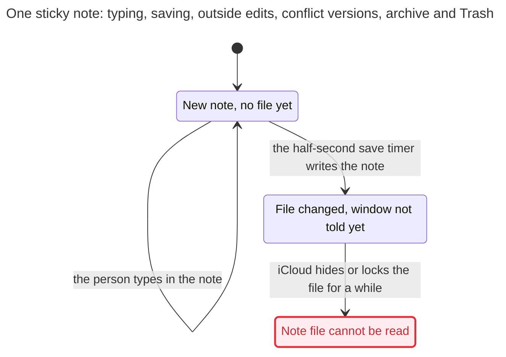

# Sticky Notes lifecycle and race model: report for the current code

Code checked: commit `c16cef1` (branch `masterpiece`, Phase 0 and Phase 1 complete), re-checked at `9f58340`, then re-run (`out-v4/`) after the six findings N1-N6 were fixed in `414f4d9` and `5d21840`. The line numbers in section 3 are those of `c16cef1`; the fixes moved them. Two TLA+ models, checked with TLC 2.19 through the statechart runner: **model (a)** `NoteDocument.tla` (one note, Obsidian vault mode, vault in iCloud Drive) and **model (b)** `DailyDocument.tla` (today's daily note across one midnight). `LineMerge.tla` holds the text operators they share. `NOTES.md` maps every action to file:line, lists the abstractions and the predictions. The output of every config is in `out-v4/<config>/` (`report.md`, `chart.mmd`, `tlc.out`); `out-v3/` is the run of `c16cef1` and `v1-cbbec66/` the first run.

This is the Definition of done item "the `model/` spec re-run against the new transitions".

## 1. Conclusion

**On the fixed code every rule holds in every config that models it. The six findings N1-N6 of the `c16cef1` run are fixed; none lost text.** No typed text is lost (`TypedTextKept`, `DailyTextKept`) in any config that models the code as it is. Each finding is kept as a regress config that breaks when its `ALLOW_OLD_*` switch is on (section 5), and its base holds.

| ID | Problem | Rule | Severity | Fixed in |
| --- | --- | --- | --- | --- |
| N1 | Obsidian writes back an older copy of the note; after the person edited a line, that copy is appended as a "Conflicted copy" of the person's own text | NoSpuriousConflictBlock | Low-medium | `414f4d9` (a follow-up in `5d21840`) |
| N2 | A blank file next to a conflict version that has text gets a divider instead of the text | NoSpuriousConflictBlock | Low | `414f4d9` |
| N3 | A window whose file cannot be read cannot be closed | CloseAlwaysWorks | Low | `414f4d9` |
| N4 | The write lineage ends at any read of a file that is not our newest write, and at relaunch: an older save of this Mac then merges as a "Conflicted copy" | NoSpuriousConflictBlock | Low-medium (depends on iCloud self-conflicts, hypothesis H1) | `414f4d9`, `5d21840` |
| N5 | The lineage vouches only while the file is exactly our newest write: one outside append in between, or an older own copy put back, turns an older own save into a "Conflicted copy" | NoSpuriousConflictBlock | Low | `414f4d9`, `5d21840` |
| N6 | A conflict merge that could not be written is retried only by the next file event | ConflictVersionsMerged | Low | `414f4d9` |

The owner's original bug (a "Conflicted copy" while typing in a new note) had three paths in the first run. H1 (iCloud keeps an older save of this Mac) is fixed: `n-owner-h1` holds (383 states). H2 (the creation echo of a note created with text) is fixed: `n-conflicts-prefilled` holds. The third, Obsidian writing back an older copy, was **N1**; N4 and N5 were the older-save path (H1) when the lineage could not vouch. All three paths are closed.

What the fix is, and where it is stricter than the first proposal of this report (which was "drop any own version"): the lineage lists what this Mac wrote, newest last. An earlier write adds nothing, so it may be dropped, only while the person was the one who took lines out of the note since. The lineage therefore ends when a document takes over text that lacks lines it showed (an outside version replaced them, or the window started from a file that does not hold them): an earlier write may then hold the only copy. An outside append, a property rewrite, or an older own copy that the window did not adopt leaves it alone. The sweep drops an earlier own version only while our newest write's text is still in the merge, and when the file is an earlier write of ours that was put back, our newest text stands in for it. The model encodes all this (`Adopted`, `DropsOwn`, `StaleFile`). One outcome remains by design and is not counted as spurious (`brk`): after the window adopted an outside version that took lines out, a "Conflicted copy" of this Mac's own older save is kept, because that save may hold the only copy of what the outside took out. `5d21840` fixes a bug in the first fix that TLC found (`TypedTextKept` broke): the newest write may be a merge that holds the other Mac's text, so it is not evidence of "our own older text".

All 73 configs are under 100,000 states (largest 81,866), so every rule is checked in every config. All 52 regress configs hold when their `ALLOW_OLD_*` switches are set back to FALSE (checked, `run-all.sh`).

## 2. Rules and results

"Holds" means TLC explored every state of every config that has the rule. The first block is about the fixed code; configs that switch a fixed finding or an old bug back on are in section 5.

### Model (a)

| Rule | Result on the current code | Configs |
| --- | --- | --- |
| `TypedTextKept`: no typed or outside line is lost, counting the window, a held-back edit, the file wherever it is, a conflict version, a recovered copy and a recovery file | **holds** | all `n-*` rounds without a switch |
| `NoSpuriousConflictBlock`: a "Conflicted copy" block appears only when each side has text the other lacks and one side's extra text is outside-authored (or the lineage ended because outside text took lines out) | holds (broke on N1, N2, N4, N5 at `c16cef1`) | `n-edits`, `n-blank-winner`, `n-lineage`, `n-relaunch` |
| `NoRepeatedText`: a merge never leaves a line outside the blocks twice | holds | all |
| `WindowMatchesDisk`: with nothing in flight and the person elsewhere, the window shows the file and holds no deferred edit | holds | all |
| `OneLifecycleState`: a note is never in two folders | holds | `n-removal`, `n-lifecycle`, `n-failure` |
| `PurgeRespectsRetention`: purge never removes a note whose last write into the Trash is under 30 days old | holds | `n-lifecycle`, `n-failure` |
| `NoFalseClose`: a window is never closed for a note still in the active folder | holds | `n-removal`, `n-removal-ph` |
| `NoUntouchedBlankFile`: an untouched new note leaves no file | holds | `n-new-note` |
| `CloseAlwaysWorks`: whenever writes work, the close button ends with the window closed and every typed line somewhere (a recovery file counts) | holds (broke on N3 at `c16cef1`) | `n-unreadable`, every other config |
| `GoneWindowCloses` (liveness, fair disk, listing and iCloud): a window whose note is gone is closed | holds | `n-live` (47,983 states) |

### Model (b)

| Rule | Result on the current code | Configs |
| --- | --- | --- |
| `DailyTextKept` | **holds** | all `d-*` |
| `ClockNeverCreates`, `DuplicateOnlyFromTwoPeople` | hold; a duplicate is reachable (probe `d-probe-duplicate` breaks in 6 steps) | `d-create`, `d-midnight` |
| `RightDay` | holds (also when the rollover waits on a failed write: `d-failure`) | `d-midnight`, `d-failure` |
| `NoSpuriousConflictBlock`, `NoRepeatedText`, `WindowMatchesDisk` | hold (N2, a blank daily file, is fixed) | `d-conflicts`, `d-conflicts-blank` |
| `ConflictVersionsMerged`: no conflict version waits while the Mac can merge it and nothing is pending | holds (broke on N6 at `c16cef1`) | `d-failure` |

### All configs without a regress switch

### Model (a)

| Config | Run | States | Result |
| --- | --- | ---: | --- |
| `n-unreadable` | The note's file cannot be read for a while: a refused close falls back to a recovery file (N3 fixed). | 3,951 | holds |
| `n-removal-ph` | A placeholder hides where the note went; writes fail for a while; the file is moved or deleted. | 19,033 | holds |
| `n-removal` | The file leaves the active folder (other Mac archives, trashes, deletes) or cannot be listed; the panel archives. | 15,204 | holds |
| `n-relaunch` | This Mac's older save is kept by iCloud, the app quits and relaunches, the sweep runs: the lineage survives the relaunch (N4 fixed). | 1,950 | holds |
| `n-owner-h1` | The owner's bug: iCloud keeps an older save of this Mac as a conflict version; no other writer. | 383 | holds |
| `n-new-note` | A blank new note has no file until its first edit; typing and erasing, the panel, quit and relaunch. | 8,318 | holds |
| `n-live` | Liveness: a window whose note is gone is closed once the disk, the listing and iCloud answer. | 47,983 | holds |
| `n-lineage` | This Mac's older saves kept by iCloud, Obsidian appends or rewrites back to an older own copy, the sweep: the lineage survives outside writes (N4) and an older own save is dropped when an outside write changed the file since (N5). | 68,888 | holds |
| `n-lifecycle` | Archive, Trash, 30 days, purge at launch, quit and relaunch; text typed into a note trashed under the window. | 9,277 | holds |
| `n-failure` | Writes fail for a while: retries, close, quit, relaunch. | 77,885 | holds |
| `n-edits-two` | Two outside lines in a row against an idle and a typing window (F2). | 10,938 | holds |
| `n-edits` | Typing against Obsidian: outside appends, property-only rewrites, stale rewrites back to an older own copy (N1 fixed), two outside lines. | 5,920 | holds |
| `n-conflicts-prefilled` | Conflict versions for a note created with captured text; all fixes in. | 26,788 | holds |
| `n-capture-fail` | A captured note whose creating write failed. | 23,632 | holds |
| `n-blank-winner` | The other Mac's offline edit arrives as a conflict version of a note the person erased: a blank file takes the text (N2 fixed). | 54,758 | holds |

### Model (b)

| Config | Run | States | Result |
| --- | --- | ---: | --- |
| `d-probe-duplicate` | Reachability probe: a numbered duplicate can occur (must break). | 4,213 | **breaks**: ProbeNoDuplicateEver (6 steps) |
| `d-midnight` | This Mac types just before midnight, rolls over, iCloud evicts the file, the other Mac edits after a sync. | 60,219 | holds |
| `d-failure` | Writes fail for a while around midnight: the rollover waits, the typing stays, a merge that could not be written is retried (N6 fixed). | 16,902 | holds |
| `d-create` | The day's file is created on this Mac and, offline, on the other Mac; a numbered duplicate may result. | 4,213 | holds |
| `d-conflicts-blank` | As d-conflicts with no template: a blank daily file takes the conflict version that has text (N2 fixed). | 3,047 | holds |
| `d-conflicts` | The other Mac edits an older copy offline, iCloud keeps this Mac's older saves: conflict versions of today's file. | 4,482 | holds |

Each finding of section 3 has a config that shows it at `c16cef1` (a regress config with the switch on, section 5) and a base that holds (the config above of the same name, or the `regress-*` base check). The peel rounds of the first report (`-r2`, `-r3`) are gone: the round-1 configs became the regress configs `regress-note-own-copy-block`, `regress-note-blank-winner-block`, `regress-daily-blank-winner-block`, `regress-note-close-refused-unreadable`, `regress-daily-no-merge-retry`, `regress-note-relaunch-lineage-reset`, `regress-note-lineage-reset` and `regress-note-lineage-needs-newest`, and the last round of each chain took the plain name.

## 3. The six findings of the `c16cef1` run (all fixed)

"Confirmed" means each step of the trace was replayed by reading the lines given, at `c16cef1`. The models are abstractions (section 7); a trace that needs iCloud or Obsidian to behave a certain way says so. Each finding ends with the status after the fix. Config names are those of the fixed run: the trace of each is the regress config named in section 5.

### N1: an outside rewrite back to an older copy of our own text becomes a "Conflicted copy"

- **What happens:** the person saves two lines, edits the first line (backspace or mid-line insert), and while that edit is unsaved Obsidian (open on the note, or a plugin) writes back the older copy. The window holds it back as an outside edit. At the next save `mergePendingExternal` finds that both sides changed the body (the buffer by the edit, the file against the base), no append-only shortcut applies, and `ConflictResolver.mergeBodies` appends the older copy under a divider. That text is the person's own earlier text.
- **Rule and trace:** `NoSpuriousConflictBlock`, config `regress-note-own-copy-block` (the config `n-edits` before the fix), 7 steps: the person types a line; the save timer writes; types a second line; the save timer writes; the person edits the first line; Obsidian rewrites the file from the older copy; the save timer writes and the divider appears.
- **Code:** NoteDocument.swift:329-375 (`mergePendingExternal`), 381-397 (`mergedBody`); ConflictResolver.swift:74-87 (`mergeBodies`: `isCovered` fails because the edited line differs; `isSuperset` fails). Nothing in `mergePendingExternal` asks whether the outside body is one this document wrote; `WriteLineage` is consulted only by `versionsToMerge` (ConflictResolver.swift:95-103) for conflict versions.
- **Severity: low-medium.** No text is lost; the note gets a duplicate block. It needs a second writer on the same file within one debounce, which is the owner's set-up (Obsidian on the same Mac).
- **Fix:** an outside body that is exactly an earlier write of this Mac (from the lineage, not the newest one) adds nothing when the buffer has unsaved edits: the buffer is kept (`NoteDocument.mergePendingExternal`, `NoteRepository.isEarlierOwnBody`). An outside body with a line none of our writes had is merged as before. The newest write is excluded because it may be a merge that holds the other Mac's text (found by TLC in the first version of the fix, `5d21840`).
- **Test:** `testAnOutsideRewriteBackToAnOlderOwnCopyIsNotAppendedAsAConflict`, `testAnOutsideRewriteWithALineNoWriteOfOursHadIsStillMerged`, `testTheOtherMacsTextInAMergeWeWroteIsNotTakenForAnOlderCopyOfOurOwnText`.
- **Status: fixed in `414f4d9`, `5d21840`.** `n-edits` holds (5,920 states); `regress-note-own-copy-block` breaks in 7 steps.

### N2: a blank file is not replaced by a conflict version that has text

- **What happens:** `ConflictResolver.merge` replaces the winner by a loser that contains it only when the winner has text (`isSuperset` returns false for a blank base, ConflictResolver.swift:168). A blank current file (the person erased the note, or opened today's daily note with no template) next to a conflict version that holds text therefore gets that text under "Conflicted copy" with nothing above it. `mergeBodies` has the blank rule (line 83); `merge` does not.
- **Rule and trace:** `NoSpuriousConflictBlock`. `regress-note-blank-winner-block`, 5 steps: type, erase all, save (a blank file is written), the other Mac's offline edit arrives as a conflict version, the sweep. Model (b): `regress-daily-blank-winner-block`, 6 steps: midnight, rollover, open today's note on purpose (a blank file is written), upload, the other Mac's offline edit, the watcher.
- **Code:** ConflictResolver.swift:25-48 (`merge`), 166-174 (`isSuperset`), applied by NoteStore.swift:1308-1316 and DailyDocument.swift:170-178.
- **Severity: low.** A divider where one is not needed; no loss.
- **Fix:** in `merge`, a candidate with text replaces a blank base (`ConflictResolver.merge`), in notes and in the daily file.
- **Test:** `testABlankCurrentFileTakesAConflictVersionWithoutADivider` (in `ConflictResolverTests`, `OwnWriteLineageTests` and `DailyDocumentTests`).
- **Status: fixed in `414f4d9`.** `n-blank-winner` (54,758 states) and `d-conflicts-blank` (3,047) hold; `regress-note-blank-winner-block` and `regress-daily-blank-winner-block` break.

### N3: a window whose file cannot be read cannot be closed

- **What happens:** while the note's file is unreadable (Obsidian wrote frontmatter the parser rejects, or iCloud has not downloaded it), `persist` gets `.failed(unreadableOnDisk)` or `.failed(locationUnknown)`, arms a retry and returns false. `close(.archive)` returns `.refused`. `DeskController.onCloseRefused` takes the recovery-file way out only when `controller.isStranded`, and `isStranded` is set only when the note's file is gone and the text could not be kept (NoteDocument.swift:508-511). So the close button beeps and offers a retry, for as long as the file stays unreadable. No text is lost: the retry keeps it dirty, and quitting writes a recovery file.
- **Rule and trace:** `CloseAlwaysWorks`. `regress-note-close-refused-unreadable`, 3 steps: type, save, the file becomes unreadable. The model reports the break in the third state: from there the close step ends with the window open.
- **Code:** NoteStore.swift:295, 336 (`.failed`); NoteDocument.swift:491-493 (`.failed` -> `scheduleRetry`, not stranded), 508-511; NoteWindowController.swift:515-528; DeskController.swift:118-128.
- **Severity: low.** Rare, and the text is safe.
- **Fix:** after a refused close, `DeskController.onCloseRefused` takes the recovery-file way out also when the last write failed because the file cannot be read or found (`NoteDocument.fileCannotBeRead`), not only when stranded. The window's text goes to a recovery file whether or not it counts as unsaved, and the window closes.
- **Test:** `testClosingANoteWhoseFileCannotBeReadWritesARecoveryFile`, `testClosingAnUntouchedNoteWhoseFileCannotBeReadAlsoWritesARecoveryFile`.
- **Status: fixed in `414f4d9`.** `n-unreadable` holds (3,951 states); `regress-note-close-refused-unreadable` breaks in 3 steps.

### N4: the write lineage ends at a foreign read and at relaunch

- **What happens:** `WriteLineage` is what tells an older save of this Mac (kept by iCloud as a conflict version, hypothesis H1) from another Mac's text. `readMainSnapshot` clears it whenever it reads a file that is not our newest write, and it lives in memory only (NoteStore.swift:95, 1256-1263, 128). So once Obsidian or the other Mac has written the file and the window has read it, or after a quit and relaunch, an older own save that iCloud keeps afterwards is not recognised: if the person has edited that line since, it is appended as a "Conflicted copy".
- **Rule and trace:** `NoSpuriousConflictBlock`. `regress-note-lineage-reset`, 7 steps: type, save, type, save, type, Obsidian writes back an older copy, the save reads it and ends the lineage, so the older copy is appended (first run: `n-lineage`, 8 steps: save, save, the person edits the first line, iCloud keeps the older save as a conflict version, Obsidian rewrites the file from an older copy, the sweep). `regress-note-relaunch-lineage-reset`, 7 steps: type, save, edit a line, quit (the flush writes it), relaunch, iCloud keeps the older save, the sweep.
- **Code:** NoteStore.swift:1256-1263, 1308-1313 (`versionsToMerge` with `isNewestOwnWrite`); ConflictResolver.swift:95-103; the comment at NoteStore.swift:90-95 states the limit.
- **Severity: low-medium.** It needs H1 (unproven) and a second writer or a relaunch.
- **Fix:** a read no longer ends the lineage; it ends when a document takes over text that lacks lines it showed (`WriteLineage.adopted`), which keeps the adoption race safe (`testAnOwnVersionIsMergedAfterAdoptingAnotherMacsFile`). The lineage is saved in a machine-local file, `write-lineage.json` in Settings' machine files folder, never in a storage root (at most 64 writes for each of the 300 newest files, and the newest write's text up to 20,000 characters), loaded at launch and saved at quit.
- **Test:** `testAnOlderOwnSaveIsStillDroppedAfterAnOutsideWriteAndAfterARelaunch`, `testTheSavedLineageIsBoundedAndIsKeptApartFromTheStorageRoots`, `testAnEarlierOwnSaveIsKeptWhenAnOutsideWriteTookItsLinesOut`.
- **Status: fixed in `414f4d9`, `5d21840`.** `n-relaunch` holds (1,950 states); `regress-note-relaunch-lineage-reset` and `regress-note-lineage-reset` break (7 steps).

### N5: the lineage vouches only while the file is exactly our newest write

- **What happens:** `versionsToMerge` drops an own older version only when `currentIsOurNewest` (ConflictResolver.swift:101). One outside append after our last save makes the current file "foreign", so an own older version that the person has since edited away is merged and appended. The rule is deliberate (an own older copy may hold text the outside writer removed), and it costs a block of own text.
- **Rule and trace:** `NoSpuriousConflictBlock`, `regress-note-lineage-needs-newest` (`n-lineage-r2` in the first run), 9 steps: save, save, edit the first line, iCloud keeps the older save as a conflict version, save, Obsidian rewrites the file from an older copy, the sweep.
- **Code:** ConflictResolver.swift:95-103; NoteStore.swift:1308-1313.
- **Severity: low.** Needs H1 and an outside write in between.
- **Fix:** `ConflictResolver.versionsToMerge` drops an earlier own version when the newest own write is still in the merge: the file covers its text (an outside append no longer stops it), or it is itself one of the versions; the newest write itself is never dropped. When the file is an earlier write of ours that was put back, our newest text stands in for it (`standingInForStaleFile`) and is written back. This is the covers-test the first report called safer; the model now encodes it (`DropsOwn`, `StaleFile`) instead of "drop any own version", which this report's first proposal would have allowed to drop the only copy of text.
- **Test:** `testAnOlderOwnSaveIsDroppedAfterAnOutsideAppend`, `testAnOlderOwnSaveIsDroppedWhenAnEarlierOwnCopyWasPutBack` (also for the daily file), `testTheSweepKeepsTheWindowsNewestTextWhenAnEarlierOwnCopyWasPutBack`, `testAnOlderOwnBodyAsTheFileNeverLetsANewerOwnSaveBeDropped`.
- **Status: fixed in `414f4d9`, `5d21840`.** `n-lineage` holds (68,888 states); `regress-note-lineage-needs-newest` breaks in 9 steps.

### N6: a conflict merge that could not be written has no retry

- **What happens:** when the write of the merged text fails (disk full), `resolveConflict` and `DailyFile.resolveConflicts` leave the versions in place (`mergeLanded = false`). The next try is the next file event or the next launch; no timer is armed. The text is safe in the conflict version, but today's note shows the winner only until something happens.
- **Rule and trace:** `ConflictVersionsMerged`, `regress-daily-no-merge-retry`, 12 steps: midnight, rollover, open today's note, type, upload, save, the other Mac appends, iCloud keeps this Mac's version as a conflict version, the disk fills, the watcher runs (the merge cannot be written), the disk accepts writes again: no event follows and the version waits.
- **Code:** NoteStore.swift:1296-1306, 1328-1333; DailyDocument.swift:157-167, 182-186, 409-413; trigger only from `handleFileSystemEvent` (NoteStore.swift:979-983) and `storeDidChange`.
- **Severity: low.** Needs a failing disk at the moment of the merge.
- **Fix:** a merge that could not be written, or that waited on a window's text that could not be written, is retried with the save retry's back-off (5 s doubling to 5 min): `NoteStore` (new `scheduler` parameter) and `DailyDocument`. The note model does not model the sweep trigger, so N6 is shown in model (b) and read from the code for `NoteStore`.
- **Test:** `testAConflictMergeThatCouldNotBeWrittenIsRetried` (in `OwnWriteLineageTests` and `DailyDocumentTests`), `testAConflictMergeThatWaitedOnAWindowsTextIsRetried`.
- **Status: fixed in `414f4d9`.** `d-failure` holds (16,902 states); `regress-daily-no-merge-retry` breaks in 12 steps.

### Not findings

- **Check-then-write gap in `NoteStore.save`:** the CAS check and the write are two steps (comment at NoteStore.swift:260), so an outside writer inside that gap is overwritten. The code states it; the models take CAS as atomic. Residual risk, not new.
- **Dropped by the use case:** two Macs or two people typing at once (R8, the two-Mac form of R10).
- **Panel and reconcile after F5:** `regress-note-panel-no-flush` holds because the keep-text path catches what the missing flush would lose. The flush is defence in depth.

## 4. Findings fixed since the first model run

The first model run (cbbec66) found F1-F10, the run of `c16cef1` found N1-N6. Each has an `ALLOW_OLD_*` switch and a config that breaks (section 5).

| ID | What | Fixed in |
| --- | --- | --- |
| F1 | A merge appends text the winner already has; the owner's "Conflicted copy" bug | b926059 (line-based merge), de79c48 (write lineage), 700a457 (three-way merge) |
| F2 | An open note stops following outside edits (stale base) | 0f3df79 (`NoteDocument`), 700a457 (base = the file's text) |
| F3 | Discarding an "empty" note deletes unseen text | 71d3ec6 (fold in outside text first), a9f5c10 (discard moves to the Trash) |
| F4 | A save overwrites an outside write the watcher has not reported | 4997f7c (compare-and-swap with the fingerprint) |
| F5 | A note that leaves the active folder loses the window's text | b63921f (keep text where the note went), bba4a4c (panel through the window, reconcile only for known-gone notes) |
| F6 | A failed write is treated as saved | dd9533f (note stays dirty, retry), 0f3df79 |
| F7 | Daily note: a reload discards unsaved typing | 97c21ac (`DailyDocument` on `NoteDocument`'s rules) |
| F8 | Daily note: a save overwrites an unreported download | 4997f7c (`DailyFile` compare-and-swap) |
| F9 | Daily note: conflict versions never merged | 2dec071, 700a457 (flush before the sweep) |
| F10 | Daily note: typing into the "waiting" placeholder is lost | 97c21ac, 5753639 (read-only while unavailable) |

| N1 | An outside rewrite back to an older copy of our own text is appended as a conflict | `414f4d9`, `5d21840` |
| N2 | A blank file is not replaced by a conflict version that has text | `414f4d9` |
| N3 | A window whose file cannot be read cannot be closed | `414f4d9` |
| N4 | The write lineage ends at a foreign read and at relaunch | `414f4d9`, `5d21840` |
| N5 | The lineage vouches only while the file is exactly our newest write | `414f4d9`, `5d21840` |
| N6 | A conflict merge that could not be written has no retry | `414f4d9` |

Plan risks on the current code: R1, R2, R5 closed (F4, F6, F8); R3, R9 closed (F5, and N3 for an unreadable file); R4 closed (F7); R6, R7 closed (F10); R10 one-Mac form closed (write on first edit b63921f, discard to the Trash a9f5c10); R11 no loss; R15 closed (97c21ac: the rollover waits, `d-failure` holds); R8 dropped; R12, R14 not modelled; R13 unchanged ("latest outside version wins").

## 5. Faithfulness: each fixed bug comes back when its switch is on

Each regress config is the holding base (the same config with every `ALLOW_OLD_*` FALSE, checked by `run-all.sh`) plus the switches named. Where a newer fix hides an old bug, the switch alone holds and a pair config shows it: the three-way merge hides the effect of a stale fingerprint, a missing echo filter, a sweep or a heal without the flush; the keep-text path hides a panel archive without the flush; each half of F3 hides the other. `regress-note-stale-persisted-mark` no longer shows `NoSpuriousConflictBlock` (12 steps) at the end of its path: that block follows an adoption that ended the lineage, which the model now counts as the safe outcome (`brk`). A regress config that holds would mean the model is blind there; none holds except the single switches named here, and each of those has its pair. The six findings N1-N6 of the `c16cef1` run are in the same form: the eight rows at the end of each table.

### Model (a)

| Switch | Old behaviour (fixed by) | Config | States | Rule broken (steps) | Shortest path |
| --- | --- | --- | --- | --- | --- |
| `ALLOW_OLD_NO_QUIT_FLUSH` | 0.1 quit dropped pending edits (458c9cd) | `regress-note-no-quit-flush` | 1,690 | TypedTextKept (2), CloseAlwaysWorks (5) | the person types in the note > the person quits the app |
| `ALLOW_OLD_PURGE_BY_MTIME` | 0.2 purge used the modification date (458c9cd) | `regress-note-purge-by-mtime` | 10,222 | TypedTextKept (6), PurgeRespectsRetention (6) | the person types in the note > the person clicks the note's close button > the calendar moves past the 30-day retention > the person deletes the note permanently > the person quits the app > the person launches the app |
| `ALLOW_OLD_ARCHIVE_NO_FLUSH` | 0.3 close archived without the last typing (458c9cd) | `regress-note-archive-no-flush` | 246 | CloseAlwaysWorks (1), TypedTextKept (2) | the person types in the note > the person clicks the note's close button |
| `ALLOW_OLD_SAVE_NO_MERGE` | 0.4 a save overwrote a deferred outside edit (458c9cd); base keeps the blind write | `regress-note-save-no-merge` | 1,223 | TypedTextKept (6), CloseAlwaysWorks (6) | the person types in the note > the half-second save timer writes the note > the person types in the note > Obsidian or the other Mac appends a line to the file > the file watcher reports the change to the window [the window holds it back] > the half-second ... |
| `ALLOW_OLD_CLOSE_NO_MERGE` | R3 r2: close did not merge the deferred edit; base keeps the blind write | `regress-note-close-no-merge` | 1,194 | CloseAlwaysWorks (4), TypedTextKept (5) | the person types in the note > the half-second save timer writes the note > Obsidian or the other Mac appends a line to the file > the file watcher reports the change to the window [the window holds it back] > the person clicks the note's close button |
| `ALLOW_OLD_APPLY_WHEN_NOT_EDITING` | 6cbd1f0: a change applied over unsaved typing when the caret was out | `regress-note-apply-when-not-editing` | 6,859 | TypedTextKept (6), CloseAlwaysWorks (6) | the person types in the note > the half-second save timer writes the note > the person types in the note > the person grabs the note's title bar > Obsidian or the other Mac appends a line to the file > the file watcher reports the change to the window [the ... |
| `ALLOW_OLD_NO_ECHO_FILTER (+ UNBASED_MERGE)` | R1 r2: own echo merged as an outside edit; alone the three-way merge absorbs it | `regress-note-no-echo-filter-unbased` | 35,080 | NoSpuriousConflictBlock (5) | the person types in the note > the half-second save timer writes the note > the person types in the note > the file watcher reports the change to the window [the window holds it back] > the person switches to another window |
| `ALLOW_OLD_SUBSTRING_MERGE` | F1: merge appended any version that was not a substring (b926059) | `regress-note-substring-merge` | 81,866 | NoSpuriousConflictBlock (4) | the person types in the note > the half-second save timer writes the note > the other Mac's offline edit arrives as a conflict version > the conflict sweep merges the conflict version [the window holds it back] |
| `ALLOW_OLD_NO_LINEAGE` | F1/H1: an older own save merged as a conflict (de79c48) | `regress-note-no-lineage` | 1,221 | NoSpuriousConflictBlock (6) | the person types in the note > the half-second save timer writes the note > the person types in the note > the half-second save timer writes the note > iCloud keeps an older save as a conflict version > the conflict sweep merges the conflict version [the wi... |
| `ALLOW_OLD_UNBASED_MERGE` | review of 1.1: merge without the base the document last saw (700a457, 94dd5d5) | `regress-note-unbased-merge` | 22,848 | NoSpuriousConflictBlock (5) | the person types in the note > the half-second save timer writes the note > the person types in the note > Obsidian rewrites the note's properties, not its text > the half-second save timer writes the note |
| `ALLOW_OLD_STALE_FP_ECHO (+ UNBASED_MERGE)` | review of 1.1: a frontmatter-only write left the fingerprint stale (700a457); alone it only costs a second read | `regress-note-stale-fp-echo-unbased` | 26,554 | NoSpuriousConflictBlock (5) | the person types in the note > the half-second save timer writes the note > the person types in the note > Obsidian rewrites the note's properties, not its text > the half-second save timer writes the note |
| `ALLOW_OLD_STALE_PERSISTED_MARK` | F2: adopting an outside version left the base stale (0f3df79, 700a457) | `regress-note-stale-persisted-mark` | 9,604 | NoRepeatedText (9), WindowMatchesDisk (9) | the person types in the note > the person grabs the note's title bar > the half-second save timer writes the note > Obsidian or the other Mac appends a line to the file > the file watcher reports the change to the window [the window shows it] > the person c... |
| `ALLOW_OLD_EMPTY_DISCARD_IGNORES_DISK + ALLOW_OLD_HARD_DELETE` | F3: empty judged from the window only, and the file unlinked (71d3ec6, a9f5c10); each half alone is covered by the other | `regress-note-empty-discard` | 13,561 | CloseAlwaysWorks (4), TypedTextKept (5) | the person types in the note > the person deletes all the text > the half-second save timer writes the note > Obsidian or the other Mac appends a line to the file > the person clicks the note's close button |
| `ALLOW_OLD_BLIND_WRITE` | F4: a save did not check the file first (4997f7c) | `regress-note-blind-write` | 7,678 | CloseAlwaysWorks (3), TypedTextKept (4) | the person types in the note > the half-second save timer writes the note > Obsidian or the other Mac appends a line to the file > the person clicks the note's close button |
| `ALLOW_OLD_GONE_AS_SAVED` | F5: a save to a note that left the folder counted as saved (b63921f) | `regress-note-gone-as-saved` | 14,704 | CloseAlwaysWorks (4), TypedTextKept (5) | the person types in the note > the half-second save timer writes the note > the person types in the note > the other Mac archives, trashes or deletes the file > the person clicks the note's close button |
| `ALLOW_OLD_RECONCILE_DROPS` | F5: reconcile closed the window and dropped unsaved typing (b63921f, bba4a4c) | `regress-note-reconcile-drops` | 16,133 | TypedTextKept (5) | the person types in the note > the half-second save timer writes the note > the person types in the note > the other Mac archives, trashes or deletes the file > the desk closes the window of a note that is gone |
| `ALLOW_OLD_PANEL_NO_FLUSH (+ RECONCILE_DROPS)` | F5/R9: the panel archived without the window's flush (bba4a4c); alone the keep-text path covers it | `regress-note-panel-no-flush-drops` | 16,133 | TypedTextKept (5) | the person types in the note > the half-second save timer writes the note > the person types in the note > the other Mac archives, trashes or deletes the file > the desk closes the window of a note that is gone |
| `ALLOW_OLD_UNLISTED_IS_GONE` | R3: a listing miss closed the window (a9f5c10, bba4a4c) | `regress-note-unlisted-is-gone` | 23,523 | NoFalseClose (4), TypedTextKept (5), CloseAlwaysWorks (7) | the person types in the note > the half-second save timer writes the note > iCloud hides or locks the file for a while > the desk closes the window of a note that is gone |
| `ALLOW_OLD_RESURRECT` | a save to a note that left the folder wrote the file again | `regress-note-resurrect` | 27,585 | OneLifecycleState (5) | the person types in the note > the half-second save timer writes the note > the person types in the note > the other Mac archives, trashes or deletes the file > the half-second save timer writes the note |
| `ALLOW_OLD_MARK_BEFORE_WRITE` | F6: a failed write counted as saved (dd9533f) | `regress-note-mark-before-write` | 2,790 | TypedTextKept (3), WindowMatchesDisk (7), CloseAlwaysWorks (7), NoSpuriousConflictBlock (8) | the person types in the note > the disk stops accepting writes > the person clicks the note's close button |
| `ALLOW_OLD_SWEEP_NO_FLUSH (+ UNBASED_MERGE)` | review of 1.1: conflict sweep before the window's text was written (700a457); alone the three-way merge covers it | `regress-note-sweep-no-flush-unbased` | 361 (stops at the violation) | NoSpuriousConflictBlock (6) | the person types in the note > the half-second save timer writes the note > the person types in the note > the half-second save timer writes the note > Obsidian rewrites the file from an older copy > the person clicks the note's close button |
| `ALLOW_OLD_WRITE_AT_CREATION` | R10: a blank new note was written at creation (b63921f) | `regress-note-write-at-creation` | 263 | NoUntouchedBlankFile (0) |  |
| `ALLOW_OLD_CAPTURE_NO_ARM` | review of 1.2: a failed capture write armed no save (43c2c29) | `regress-note-capture-no-arm` | 721 | TypedTextKept (1) | the person quits the app |
| `ALLOW_OLD_STRANDED_CLOSE_REFUSED` | review of 1.2/1.3: a note with nowhere to go could not be closed (43c2c29) | `regress-note-stranded-close-refused` | 18,709 | CloseAlwaysWorks (5) | the person types in the note > the half-second save timer writes the note > the person types in the note > the other Mac archives, trashes or deletes the file > iCloud leaves a download placeholder in the notes folders |
| `ALLOW_OLD_TRASH_NO_STAMP` | review of 1.2/1.3: a write into a trashed file kept the old deletion date (43c2c29) | `regress-note-trash-no-stamp` | 9,556 | TypedTextKept (7), PurgeRespectsRetention (7) | the person types in the note > the half-second save timer writes the note > the person types in the note > the other Mac archives, trashes or deletes the file > the calendar moves past the 30-day retention > the person quits the app > the person launches th... |
| `ALLOW_OLD_OWN_COPY_BLOCK` | N1: an outside rewrite back to an older own copy was appended as a conflict (414f4d9, 5d21840) | `regress-note-own-copy-block` | 5,809 | NoSpuriousConflictBlock (7) | the person types in the note > the half-second save timer writes the note > the person types in the note > the half-second save timer writes the note > the person types in the note > Obsidian rewrites the file from an older copy > the ... |
| `ALLOW_OLD_BLANK_WINNER_BLOCK` | N2: a blank file got a divider next to a conflict version with text (414f4d9) | `regress-note-blank-winner-block` | 71,551 | NoSpuriousConflictBlock (5) | the person types in the note > the person deletes all the text > the half-second save timer writes the note > the other Mac's offline edit arrives as a conflict version > the conflict sweep merges the conflict version [the window holds it ... |
| `ALLOW_OLD_CLOSE_REFUSED_UNREADABLE` | N3: a close was refused for good while the file could not be read (414f4d9) | `regress-note-close-refused-unreadable` | 3,121 | CloseAlwaysWorks (3) | the person types in the note > the half-second save timer writes the note > iCloud hides or locks the file for a while |
| `ALLOW_OLD_LINEAGE_RESET` | N4: the lineage ended at a foreign read and at relaunch (414f4d9, 5d21840) | `regress-note-lineage-reset` | 15,811 | NoSpuriousConflictBlock (7) | the person types in the note > the half-second save timer writes the note > the person types in the note > the half-second save timer writes the note > the person types in the note > Obsidian rewrites the file from an older copy > the ... |
| `ALLOW_OLD_LINEAGE_RESET` | N4: the lineage was lost at relaunch (414f4d9) | `regress-note-relaunch-lineage-reset` | 7,788 | NoSpuriousConflictBlock (7) | the person types in the note > the half-second save timer writes the note > the person types in the note > the person quits the app > the person launches the app > iCloud keeps an older save as a conflict version > the conflict sweep ... |
| `ALLOW_OLD_LINEAGE_NEEDS_NEWEST` | N5: an older own save was dropped only while the file was exactly our newest write (414f4d9, 5d21840) | `regress-note-lineage-needs-newest` | 23,217 | NoSpuriousConflictBlock (9) | the person types in the note > the half-second save timer writes the note > the person types in the note > the half-second save timer writes the note > the person types in the note > iCloud keeps an older save as a conflict version > the ... |

### Model (b)

| Switch | Old behaviour (fixed by) | Config | States | Rule broken (steps) | Shortest path |
| --- | --- | --- | --- | --- | --- |
| `ALLOW_OLD_CLOCK_CREATES` | cbbec66: the rollover wrote the template, creating the file | `regress-daily-clock-creates` | 2,939 | ClockNeverCreates (2), DuplicateOnlyFromTwoPeople (5) | the clock passes midnight > the midnight timer or wake switches to today |
| `ALLOW_OLD_STUB_AS_MISSING` | 0.5: an unreadable file was treated as missing | `regress-daily-stub-as-missing` | 61,416 | DailyTextKept (7) | the clock passes midnight > the other Mac creates today's file offline > iCloud uploads the other Mac's new file > iCloud downloads the newer file to this Mac > iCloud turns the synced file into a placeholder > the midnight timer or wake switches to today >... |
| `ALLOW_OLD_APPLY_OVER_UNSAVED` | F7: reload applied the file over an armed save (97c21ac) | `regress-daily-apply-over-unsaved` | 4,571 | DailyTextKept (9) | the person clicks into the daily note > the clock passes midnight > the midnight timer or wake switches to today > the person types in the daily note > the person grabs the daily note's title bar > the other Mac creates today's file offline > iCloud uploads... |
| `ALLOW_OLD_BLIND_WRITE` | F8: a save did not check the file first (4997f7c) | `regress-daily-blind-write` | 4,393 | DailyTextKept (9), NoSpuriousConflictBlock (10) | the person clicks into the daily note > the clock passes midnight > the midnight timer or wake switches to today > the person types in the daily note > the other Mac creates today's file offline > iCloud uploads the other Mac's new file > iCloud downloads t... |
| `ALLOW_OLD_CONFLICT_UNRESOLVED` | F9: conflict versions of the daily file were never merged (2dec071) | `regress-daily-conflict-unresolved` | 1,609 | ConflictVersionsMerged (6) | the clock passes midnight > the midnight timer or wake switches to today > the person opens today's note on purpose > iCloud uploads this Mac's file > the other Mac's offline edit arrives as a conflict version > the file watcher reports the change |
| `ALLOW_OLD_PLACEHOLDER_EDITABLE` | F10: the waiting buffer took typing (97c21ac, 5753639) | `regress-daily-placeholder-editable` | 60,399 | DailyTextKept (9) | the person clicks into the daily note > the clock passes midnight > the other Mac creates today's file offline > iCloud uploads the other Mac's new file > iCloud downloads the newer file to this Mac > iCloud turns the synced file into a placeholder > the mi... |
| `ALLOW_OLD_ROLLOVER_ON_FAILED_FLUSH` | R15: midnight replaced a buffer whose save failed (97c21ac) | `regress-daily-rollover-on-failed-flush` | 22,496 | DailyTextKept (5) | the person clicks into the daily note > the person types in the daily note > the clock passes midnight > this Mac's disk stops accepting writes > the midnight timer or wake switches to today |
| `ALLOW_OLD_NO_LINEAGE` | an older own save merged as a conflict (2dec071) | `regress-daily-no-lineage` | 9,559 | NoSpuriousConflictBlock (9) | the person clicks into the daily note > the clock passes midnight > the midnight timer or wake switches to today > the person types in the daily note > the save timer writes the daily note > the person fixes a typo in today's line > the save timer writes th... |
| `ALLOW_OLD_UNBASED_MERGE` | merge without the base the document last saw (700a457) | `regress-daily-unbased-merge` | 5,604 | NoSpuriousConflictBlock (13) | the person clicks into the daily note > the clock passes midnight > the midnight timer or wake switches to today > the person types in the daily note > the save timer writes the daily note > iCloud uploads this Mac's file > the other Mac's offline edit arri... |
| `ALLOW_OLD_SWEEP_NO_FLUSH (+ UNBASED_MERGE)` | conflict versions merged before the typing was written (700a457); alone the three-way merge covers it | `regress-daily-sweep-no-flush-unbased` | 5,646 | NoSpuriousConflictBlock (13) | the person clicks into the daily note > the clock passes midnight > the midnight timer or wake switches to today > the person types in the daily note > the save timer writes the daily note > iCloud uploads this Mac's file > the other Mac's offline edit arri... |
| `ALLOW_OLD_HEAL_NO_FLUSH (+ UNBASED_MERGE)` | a numbered duplicate healed before the typing was written (94dd5d5); alone the three-way merge covers it | `regress-daily-heal-no-flush-unbased` | 4,931 | NoSpuriousConflictBlock (14) | the person clicks into the daily note > the clock passes midnight > the midnight timer or wake switches to today > the person types in the daily note > the save timer writes the daily note > iCloud uploads this Mac's file > the other Mac creates today's fil... |
| `ALLOW_OLD_BLANK_WINNER_BLOCK` | N2: a blank daily file got a divider next to a conflict version (414f4d9) | `regress-daily-blank-winner-block` | 3,545 | NoSpuriousConflictBlock (6) | the clock passes midnight > the midnight timer or wake switches to today > the person opens today's note on purpose > iCloud uploads this Mac's file > the other Mac's offline edit arrives as a conflict version > the file watcher reports ... |
| `ALLOW_OLD_NO_MERGE_RETRY` | N6: a merge that could not be written waited for the next file event (414f4d9) | `regress-daily-no-merge-retry` | 14,814 | ConflictVersionsMerged (12) | the person clicks into the daily note > the clock passes midnight > the midnight timer or wake switches to today > the person opens today's note on purpose > the person types in the daily note > iCloud uploads this Mac's file > the save ... |

Single-switch configs that hold, by design (each is next to its pair above): `regress-note-stale-fp-echo`, `regress-note-no-echo-filter`, `regress-note-sweep-no-flush`, `regress-note-panel-no-flush`, `regress-note-empty-discard-no-fold`, `regress-note-hard-delete`, `regress-daily-sweep-no-flush`, `regress-daily-heal-no-flush`. The switch `ALLOW_OLD_NO_BASE_ON_EQUAL` (a file equal to the buffer not made the base) is not checkable: it needs an outside writer to produce exactly the window's text, which a token model cannot tell from two people typing the same line, so the action and the switch were removed.

## 6. Model artefacts (found and fixed, not findings)

See `NOTES.md`: a reused token after "erase", an asymmetric "genuine conflict" test, a sign error on the blank-winner switch, a missing stale fingerprint on downloads, the lineage cleared from the pre-flush state at quit, recovery files replacing each other, an `ExternalCopy` action that was a duplicate-typing artefact, and two liveness encodings that were too slow or did not finish.

## 7. What the models leave out

- Title, labels, colour, geometry and `preserved` (1.8): only bodies and the fingerprint bit are modelled. The three-way decision per field was read from the code, not checked.
- The storage switch (1.5, R12) and the sweep moved off the launch path (1.6; same ordering as before).
- Real time: debounces, retry back-off (5 s to 5 min) and the 5 s sweep limit are orderings. A path that needs a step inside one debounce is possible, not likely.
- The check-then-write gap in `NoteStore.save`; several conflict versions at once; nested divider counts (one `D` token); the "last line is a prefix" rule in `isCovered`.
- An unreadable file with a name that does not carry the note's id is judged missing by `whereIs` (it is the one case `listed` does not model).
- Two people or two Macs typing at once (use case, 2026-11-15). The second Mac acts only through the file system and iCloud.
- The sweep's stand-in for a stale file (`StaleFile`) and the lineage file are modelled as one rule each; the saved file's bounds (64 writes, 300 files, 20,000 characters) are not. A write that falls out of the bounds is no longer an own write, so the version is merged as before.
- Whether iCloud makes self-conflicts at all (H1). The model assumes it can; the first report's probe (log `localizedNameOfSavingComputer`) is still the way to settle it.

## 8. Charts

The bug-path chart of `regress-note-close-refused-unreadable` (N3 at `c16cef1`; s2 breaks `CloseAlwaysWorks`). Every other chart is in `out-v4/<config>/chart.mmd` (bug path only above 500 states). Some bug-path charts (`n-owner-h1` and regress configs) still carry one or two label warnings: two actions between the same two coarse chart states share a label (typing and erasing), or one arrow label leaves a state for two states. No step is hidden.



## 9. Commands to rerun

```sh
cd /Users/ronica/projects/sticky-notes/.claude/worktrees/masterpiece/model
./run-all.sh out-new        # every config of both models, then the base check of every regress config
```

One config:

```sh
R=/Users/ronica/.claude/plugins/cache/ronica-skills/statechart/0.3.0/skills/statechart/scripts/statechart
export TLA2TOOLS=$HOME/.cache/statechart/tla2tools.jar JAVA=/opt/homebrew/opt/openjdk/bin/java
$R NoteDocument.tla --config n-lineage.cfg --view note-doc-view.mjs --out out-new/n-lineage
$R DailyDocument.tla --config d-failure.cfg --view daily-doc-view.mjs --out out-new/d-failure
```

Use a new `--out` folder for each run.
