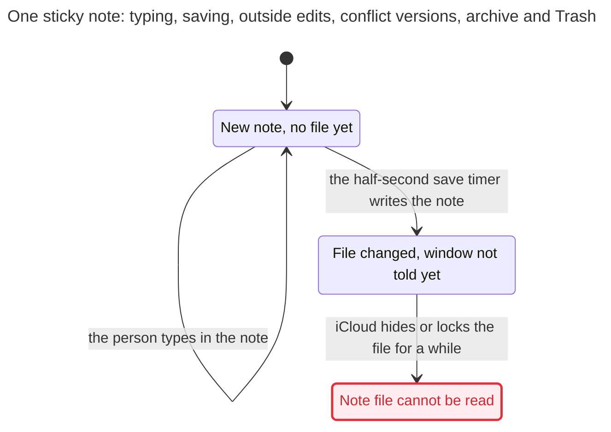

# Sticky Notes lifecycle and race model: report for the current code

Code checked: commit `c16cef1` (branch `masterpiece`, Phase 0 and Phase 1 complete). Re-checked at `9f58340` (HEAD when this report was finished): `ConflictResolver.swift` is unchanged, and the later changes to `NoteStore`, `NoteDocument`, `DailyDocument`, `DeskController` and `NoteWindowController` are about layout, geometry, the storage switch and the Note menu (⌘W calls the same `closeNote`); no modelled transition changed, and the anchor of each of N1-N6 is still there. The line numbers below are those of `c16cef1`. Two TLA+ models, checked with TLC 2.19 through the statechart runner: **model (a)** `NoteDocument.tla` (one note, Obsidian vault mode, vault in iCloud Drive) and **model (b)** `DailyDocument.tla` (today's daily note across one midnight). `LineMerge.tla` holds the text operators they share. `NOTES.md` maps every action to file:line, lists the abstractions and the predictions. The output of every config is in `out-v3/<config>/` (`report.md`, `chart.mmd`, `tlc.out`). The first run (cbbec66) is kept in `v1-cbbec66/`.

This is the Definition of done item "the `model/` spec re-run against the new transitions".

## 1. Conclusion

**On the current code every data-loss rule holds. Six new problems remain; none loses text.** No typed text is lost (`TypedTextKept`, `DailyTextKept`) in any config that models the code as it is, and the other rules hold, except the six below. All six are confirmed by reading the code; no test was run and none was added (Sources and Tests were not edited).

| ID | Problem | Rule | Severity |
| --- | --- | --- | --- |
| N1 | Obsidian writes back an older copy of the note; after the person edited a line, that copy is appended as a "Conflicted copy" of the person's own text | NoSpuriousConflictBlock | Low-medium |
| N2 | A blank file next to a conflict version that has text gets a divider instead of the text | NoSpuriousConflictBlock | Low |
| N3 | A window whose file cannot be read cannot be closed | CloseAlwaysWorks | Low |
| N4 | The write lineage ends at any read of a file that is not our newest write, and at relaunch: an older save of this Mac then merges as a "Conflicted copy" | NoSpuriousConflictBlock | Low-medium (depends on iCloud self-conflicts, hypothesis H1) |
| N5 | The lineage vouches only while the file is exactly our newest write: one outside append in between turns an older own save into a "Conflicted copy" | NoSpuriousConflictBlock | Low |
| N6 | A conflict merge that could not be written is retried only by the next file event | ConflictVersionsMerged | Low |

The owner's original bug (a "Conflicted copy" while typing in a new note) had three paths in the first run. H1 (iCloud keeps an older save of this Mac) is fixed: `n-owner-h1` holds (383 states). H2 (the creation echo of a note created with text) is fixed: `n-conflicts-prefilled` holds. The third, Obsidian writing back an older copy, survives as **N1**. N4 and N5 are the older-save path (H1) when the lineage cannot vouch. Each of these needs a second writer or a relaunch.

All 73 configs are under 100,000 states (largest 81,866), so every rule is checked in every config. All 44 regress configs hold when their `ALLOW_OLD_*` switches are set back to FALSE (checked, `run-all.sh`).

## 2. Rules and results

"Holds" means TLC explored every state of every config that has the rule. The first block is about the code as it is; configs that switch on a new finding or an old bug are in sections 3 and 5.

### Model (a)

| Rule | Result on the current code | Configs |
| --- | --- | --- |
| `TypedTextKept`: no typed or outside line is lost, counting the window, a held-back edit, the file wherever it is, a conflict version, a recovered copy and a recovery file | **holds** | all `n-*` rounds without a switch |
| `NoSpuriousConflictBlock`: a "Conflicted copy" block appears only when each side has text the other lacks and one side's extra text is outside-authored | **breaks**: N1, N2, N4, N5; holds after each is fixed | `n-edits`, `n-blank-winner`, `n-lineage`, `n-relaunch` and their `-r2`/`-r3` |
| `NoRepeatedText`: a merge never leaves a line outside the blocks twice | holds | all |
| `WindowMatchesDisk`: with nothing in flight and the person elsewhere, the window shows the file and holds no deferred edit | holds | all |
| `OneLifecycleState`: a note is never in two folders | holds | `n-removal`, `n-lifecycle`, `n-failure` |
| `PurgeRespectsRetention`: purge never removes a note whose last write into the Trash is under 30 days old | holds | `n-lifecycle`, `n-failure` |
| `NoFalseClose`: a window is never closed for a note still in the active folder | holds | `n-removal`, `n-removal-ph` |
| `NoUntouchedBlankFile`: an untouched new note leaves no file | holds | `n-new-note` |
| `CloseAlwaysWorks`: whenever writes work, the close button ends with the window closed and every typed line somewhere (a recovery file counts) | **breaks**: N3; holds after the fix | `n-unreadable`, `n-unreadable-r2`, every other config |
| `GoneWindowCloses` (liveness, fair disk, listing and iCloud): a window whose note is gone is closed | holds | `n-live` (47,983 states) |

### Model (b)

| Rule | Result on the current code | Configs |
| --- | --- | --- |
| `DailyTextKept` | **holds** | all `d-*` |
| `ClockNeverCreates`, `DuplicateOnlyFromTwoPeople` | hold; a duplicate is reachable (probe `d-probe-duplicate` breaks in 6 steps) | `d-create`, `d-midnight` |
| `RightDay` | holds (also when the rollover waits on a failed write: `d-failure-r2`) | `d-midnight`, `d-failure-r2` |
| `NoSpuriousConflictBlock`, `NoRepeatedText`, `WindowMatchesDisk` | hold, except N2 (blank daily file) | `d-conflicts`, `d-conflicts-blank-r2` |
| `ConflictVersionsMerged`: no conflict version waits while the Mac can merge it and nothing is pending | **breaks**: N6; holds after the fix | `d-failure`, `d-failure-r2` |

### All configs without a regress switch

### Model (a)

| Config | Run | States | Result |
| --- | --- | ---: | --- |
| `n-blank-winner-r2` | Round 2: a blank file takes the conflict version that has text (N2 fixed). | 54,758 | holds |
| `n-blank-winner` | The other Mac's offline edit arrives as a conflict version of a note the person erased (N2). Round 1: the code as it is. | 71,551 | **breaks**: NoSpuriousConflictBlock (5 steps) |
| `n-capture-fail` | A captured note whose creating write failed. | 23,632 | holds |
| `n-conflicts-prefilled` | Conflict versions for a note created with captured text; all fixes in. | 26,788 | holds |
| `n-edits-r2` | Round 2: an outside rewrite back to an older own copy is not appended as a conflict (proposed fix N1). | 9,677 | holds |
| `n-edits-two` | Two outside lines in a row against an idle and a typing window (F2). | 10,938 | holds |
| `n-edits` | Typing against Obsidian: outside appends, property-only rewrites, stale rewrites, two outside lines. Round 1: the code as it is. | 6,489 | **breaks**: NoSpuriousConflictBlock (7 steps) |
| `n-failure` | Writes fail for a while: retries, close, quit, relaunch. | 67,456 | holds |
| `n-lifecycle` | Archive, Trash, 30 days, purge at launch, quit and relaunch; text typed into a note trashed under the window. | 7,868 | holds |
| `n-lineage-r2` | Round 2: the lineage survives foreign writes (N4 fixed). | 42,055 | **breaks**: NoSpuriousConflictBlock (9 steps) |
| `n-lineage-r3` | Round 3: an older own save is dropped when an outside edit changed the file since (N5 fixed). | 17,924 | holds |
| `n-lineage` | This Mac's older saves kept by iCloud, Obsidian appends or rewrites, the sweep. Round 1: the lineage ends at a foreign read (N4) and needs the newest write (N5). | 76,608 | **breaks**: NoSpuriousConflictBlock (8 steps) |
| `n-live` | Liveness: a window whose note is gone is closed once the disk, the listing and iCloud answer. | 47,983 | holds |
| `n-new-note` | A blank new note has no file until its first edit; typing and erasing, the panel, quit and relaunch. | 8,318 | holds |
| `n-owner-h1` | The owner's bug: iCloud keeps an older save of this Mac as a conflict version; no other writer. | 383 | holds |
| `n-relaunch-r2` | N4 fixed: the lineage survives a relaunch. | 1,950 | holds |
| `n-relaunch` | N4: this Mac's older save is kept by iCloud, the app quits and relaunches (the lineage is in memory), the sweep runs. Round 1. | 7,788 | **breaks**: NoSpuriousConflictBlock (7 steps) |
| `n-removal-ph` | A placeholder hides where the note went; writes fail for a while; the file is moved or deleted. | 19,033 | holds |
| `n-removal` | The file leaves the active folder (other Mac archives, trashes, deletes) or cannot be listed; the panel archives. | 15,204 | holds |
| `n-unreadable-r2` | N3 fixed: a refused close falls back to a recovery file. | 3,951 | holds |
| `n-unreadable` | N3: the note's file cannot be read for a while; can the window be closed? Round 1. | 3,121 | **breaks**: CloseAlwaysWorks (3 steps) |

### Model (b)

| Config | Run | States | Result |
| --- | --- | ---: | --- |
| `d-conflicts-blank-r2` | Round 2: a blank file takes the conflict version that has text (N2 fixed). | 3,210 | holds |
| `d-conflicts-blank` | As d-conflicts with no template: a blank daily file next to a conflict version (N2 in the daily file). Round 1. | 3,708 | **breaks**: NoSpuriousConflictBlock (6 steps) |
| `d-conflicts` | The other Mac edits an older copy offline, iCloud keeps this Mac's older saves: conflict versions of today's file. | 4,994 | holds |
| `d-create` | The day's file is created on this Mac and, offline, on the other Mac; a numbered duplicate may result. | 4,058 | holds |
| `d-failure-r2` | Round 2: a merge that could not be written is retried (N6 fixed). | 15,462 | holds |
| `d-failure` | Writes fail for a while around midnight: the rollover waits, the typing stays. Round 1: the code as it is. | 15,222 | **breaks**: ConflictVersionsMerged (12 steps) |
| `d-midnight` | This Mac types just before midnight, rolls over, iCloud evicts the file, the other Mac edits after a sync. | 62,214 | holds |
| `d-probe-duplicate` | Reachability probe: a numbered duplicate can occur (must break). | 4,058 | **breaks**: ProbeNoDuplicateEver (6 steps) |

Peel rounds: each round sets one more new-finding switch to FALSE. `n-edits` (N1) -> `n-edits-r2`; `n-blank-winner` (N2) -> `-r2`; `n-lineage` (N4, N5) -> `-r2` (N4 fixed, N5 shows) -> `-r3`; `n-relaunch` (N4) -> `-r2`; `n-unreadable` (N3) -> `-r2`; `d-conflicts-blank` (N2) -> `-r2`; `d-failure` (N6) -> `-r2`. Every `-r` config at the end of a chain holds. The first model run's single large configs were split because the lineage doubles the state space: no config combines every actor.

## 3. New findings (confirmed by reading the code at c16cef1)

"Confirmed" means each step of the trace was replayed by reading the lines given. The models are abstractions (section 7); a trace that needs iCloud or Obsidian to behave a certain way says so.

### N1: an outside rewrite back to an older copy of our own text becomes a "Conflicted copy"

- **What happens:** the person saves two lines, edits the first line (backspace or mid-line insert), and while that edit is unsaved Obsidian (open on the note, or a plugin) writes back the older copy. The window holds it back as an outside edit. At the next save `mergePendingExternal` finds that both sides changed the body (the buffer by the edit, the file against the base), no append-only shortcut applies, and `ConflictResolver.mergeBodies` appends the older copy under a divider. That text is the person's own earlier text.
- **Rule and trace:** `NoSpuriousConflictBlock`, config `n-edits`, 7 steps: the person types a line; the save timer writes; types a second line; the save timer writes; the person edits the first line; Obsidian rewrites the file from the older copy; the save timer writes and the divider appears.
- **Code:** NoteDocument.swift:329-375 (`mergePendingExternal`), 381-397 (`mergedBody`); ConflictResolver.swift:74-87 (`mergeBodies`: `isCovered` fails because the edited line differs; `isSuperset` fails). Nothing in `mergePendingExternal` asks whether the outside body is one this document wrote; `WriteLineage` is consulted only by `versionsToMerge` (ConflictResolver.swift:95-103) for conflict versions.
- **Severity: low-medium.** No text is lost; the note gets a duplicate block. It needs a second writer on the same file within one debounce, which is the owner's set-up (Obsidian on the same Mac).
- **Fix:** keep a small set of the bodies this document wrote; in `mergePendingExternal`, an outside body that is in the set adds nothing (keep the buffer). In the model this is `ALLOW_OWN_COPY_BLOCK = FALSE` (`n-edits-r2` holds, 9,677 states).
- **Test:** `testAnOutsideRewriteBackToAnOlderOwnCopyIsNotAppendedAsAConflict`.

### N2: a blank file is not replaced by a conflict version that has text

- **What happens:** `ConflictResolver.merge` replaces the winner by a loser that contains it only when the winner has text (`isSuperset` returns false for a blank base, ConflictResolver.swift:168). A blank current file (the person erased the note, or opened today's daily note with no template) next to a conflict version that holds text therefore gets that text under "Conflicted copy" with nothing above it. `mergeBodies` has the blank rule (line 83); `merge` does not.
- **Rule and trace:** `NoSpuriousConflictBlock`. `n-blank-winner`, 5 steps: type, erase all, save (a blank file is written), the other Mac's offline edit arrives as a conflict version, the sweep. Model (b): `d-conflicts-blank`, 6 steps: midnight, rollover, open today's note on purpose (a blank file is written), upload, the other Mac's offline edit, the watcher.
- **Code:** ConflictResolver.swift:25-48 (`merge`), 166-174 (`isSuperset`), applied by NoteStore.swift:1308-1316 and DailyDocument.swift:170-178.
- **Severity: low.** A divider where one is not needed; no loss.
- **Fix:** in `merge`, a candidate with text replaces a blank base. Model: `ALLOW_BLANK_WINNER_BLOCK = FALSE` (`n-blank-winner-r2` 54,758 states and `d-conflicts-blank-r2` hold).
- **Test:** `testABlankCurrentFileTakesAConflictVersionWithoutADivider`.

### N3: a window whose file cannot be read cannot be closed

- **What happens:** while the note's file is unreadable (Obsidian wrote frontmatter the parser rejects, or iCloud has not downloaded it), `persist` gets `.failed(unreadableOnDisk)` or `.failed(locationUnknown)`, arms a retry and returns false. `close(.archive)` returns `.refused`. `DeskController.onCloseRefused` takes the recovery-file way out only when `controller.isStranded`, and `isStranded` is set only when the note's file is gone and the text could not be kept (NoteDocument.swift:508-511). So the close button beeps and offers a retry, for as long as the file stays unreadable. No text is lost: the retry keeps it dirty, and quitting writes a recovery file.
- **Rule and trace:** `CloseAlwaysWorks`. `n-unreadable`, 3 steps: type, save, the file becomes unreadable. The model reports the break in the third state: from there the close step ends with the window open.
- **Code:** NoteStore.swift:295, 336 (`.failed`); NoteDocument.swift:491-493 (`.failed` -> `scheduleRetry`, not stranded), 508-511; NoteWindowController.swift:515-528; DeskController.swift:118-128.
- **Severity: low.** Rare, and the text is safe.
- **Fix:** after a refused close, take the recovery-file way out whenever the refusal is not a write that is expected to land soon (any `.failed` from an unreadable or unlocatable file), not only when stranded. Model: `ALLOW_CLOSE_REFUSED_UNREADABLE = FALSE` (`n-unreadable-r2` holds).
- **Test:** `testClosingANoteWhoseFileCannotBeReadWritesARecoveryFile`.

### N4: the write lineage ends at a foreign read and at relaunch

- **What happens:** `WriteLineage` is what tells an older save of this Mac (kept by iCloud as a conflict version, hypothesis H1) from another Mac's text. `readMainSnapshot` clears it whenever it reads a file that is not our newest write, and it lives in memory only (NoteStore.swift:95, 1256-1263, 128). So once Obsidian or the other Mac has written the file and the window has read it, or after a quit and relaunch, an older own save that iCloud keeps afterwards is not recognised: if the person has edited that line since, it is appended as a "Conflicted copy".
- **Rule and trace:** `NoSpuriousConflictBlock`. `n-lineage`, 8 steps: save, save, the person edits the first line, iCloud keeps the older save as a conflict version, Obsidian rewrites the file from an older copy, the sweep. `n-relaunch`, 7 steps: type, save, edit a line, quit (the flush writes it), relaunch, iCloud keeps the older save, the sweep.
- **Code:** NoteStore.swift:1256-1263, 1308-1313 (`versionsToMerge` with `isNewestOwnWrite`); ConflictResolver.swift:95-103; the comment at NoteStore.swift:90-95 states the limit.
- **Severity: low-medium.** It needs H1 (unproven) and a second writer or a relaunch.
- **Fix:** keep the set of own write hashes per file across foreign reads, and across launches (a small file under Application Support), or use `NSFileVersion.localizedNameOfSavingComputer` against this Mac as plan 1.0 said. Model: `ALLOW_LINEAGE_RESET = FALSE` (`n-lineage-r2`, `n-relaunch-r2`).
- **Test:** `testAnOlderOwnSaveIsStillDroppedAfterAnOutsideWriteAndAfterARelaunch`.

### N5: the lineage vouches only while the file is exactly our newest write

- **What happens:** `versionsToMerge` drops an own older version only when `currentIsOurNewest` (ConflictResolver.swift:101). One outside append after our last save makes the current file "foreign", so an own older version that the person has since edited away is merged and appended. The rule is deliberate (an own older copy may hold text the outside writer removed), and it costs a block of own text.
- **Rule and trace:** `NoSpuriousConflictBlock`, `n-lineage-r2`, 9 steps: save, save, edit the first line, iCloud keeps the older save as a conflict version, save, Obsidian rewrites the file from an older copy, the sweep.
- **Code:** ConflictResolver.swift:95-103; NoteStore.swift:1308-1313.
- **Severity: low.** Needs H1 and an outside write in between.
- **Fix:** drop an own version when the newest own write covers it (`isCovered`), whether or not the file has been written since. The model's fix (`ALLOW_LINEAGE_NEEDS_NEWEST = FALSE`) drops any own version, which is more than that and is the simplest to state; `n-lineage-r3` (17,924 states) holds with it. The covers-test is the safer variant and is not modelled.
- **Test:** `testAnOlderOwnSaveIsDroppedAfterAnOutsideAppend`.

### N6: a conflict merge that could not be written has no retry

- **What happens:** when the write of the merged text fails (disk full), `resolveConflict` and `DailyFile.resolveConflicts` leave the versions in place (`mergeLanded = false`). The next try is the next file event or the next launch; no timer is armed. The text is safe in the conflict version, but today's note shows the winner only until something happens.
- **Rule and trace:** `ConflictVersionsMerged`, `d-failure`, 12 steps: midnight, rollover, open today's note, type, upload, save, the other Mac appends, iCloud keeps this Mac's version as a conflict version, the disk fills, the watcher runs (the merge cannot be written), the disk accepts writes again: no event follows and the version waits.
- **Code:** NoteStore.swift:1296-1306, 1328-1333; DailyDocument.swift:157-167, 182-186, 409-413; trigger only from `handleFileSystemEvent` (NoteStore.swift:979-983) and `storeDidChange`.
- **Severity: low.** Needs a failing disk at the moment of the merge.
- **Fix:** arm the document's retry timer (as `scheduleRetry` does for saves) when a merge write fails. Model: `ALLOW_NO_MERGE_RETRY = FALSE` (`d-failure-r2` holds, 15,462 states). The note model does not model the sweep trigger, so N6 is shown in model (b) and read from the code for `NoteStore`.
- **Test:** `testAConflictMergeThatCouldNotBeWrittenIsRetried`.

### Not findings

- **Check-then-write gap in `NoteStore.save`:** the CAS check and the write are two steps (comment at NoteStore.swift:260), so an outside writer inside that gap is overwritten. The code states it; the models take CAS as atomic. Residual risk, not new.
- **Dropped by the use case:** two Macs or two people typing at once (R8, the two-Mac form of R10).
- **Panel and reconcile after F5:** `regress-note-panel-no-flush` holds because the keep-text path catches what the missing flush would lose. The flush is defence in depth.

## 4. Findings fixed since the first model run

The first model run (cbbec66) found F1-F10. Each has an `ALLOW_OLD_*` switch and a config that breaks (section 5).

| ID | What | Fixed in |
| --- | --- | --- |
| F1 | A merge appends text the winner already has; the owner's "Conflicted copy" bug | b926059 (line-based merge), de79c48 (write lineage), 700a457 (three-way merge) |
| F2 | An open note stops following outside edits (stale base) | 0f3df79 (`NoteDocument`), 700a457 (base = the file's text) |
| F3 | Discarding an "empty" note deletes unseen text | 71d3ec6 (fold in outside text first), a9f5c10 (discard moves to the Trash) |
| F4 | A save overwrites an outside write the watcher has not reported | 4997f7c (compare-and-swap with the fingerprint) |
| F5 | A note that leaves the active folder loses the window's text | b63921f (keep text where the note went), bba4a4c (panel through the window, reconcile only for known-gone notes) |
| F6 | A failed write is treated as saved | dd9533f (note stays dirty, retry), 0f3df79 |
| F7 | Daily note: a reload discards unsaved typing | 97c21ac (`DailyDocument` on `NoteDocument`'s rules) |
| F8 | Daily note: a save overwrites an unreported download | 4997f7c (`DailyFile` compare-and-swap) |
| F9 | Daily note: conflict versions never merged | 2dec071, 700a457 (flush before the sweep) |
| F10 | Daily note: typing into the "waiting" placeholder is lost | 97c21ac, 5753639 (read-only while unavailable) |

Plan risks on the current code: R1, R2, R5 closed (F4, F6, F8); R3, R9 closed (F5), with N3 as the residual for an unreadable file; R4 closed (F7); R6, R7 closed (F10); R10 one-Mac form closed (write on first edit b63921f, discard to the Trash a9f5c10); R11 no loss; R15 closed (97c21ac: the rollover waits, `d-failure-r2` holds); R8 dropped; R12, R14 not modelled; R13 unchanged ("latest outside version wins").

## 5. Faithfulness: each fixed bug comes back when its switch is on

Each regress config is the holding base (the same config with every `ALLOW_OLD_*` FALSE, checked by `run-all.sh`) plus the switches named. Where a newer fix hides an old bug, the switch alone holds and a pair config shows it: the three-way merge hides the effect of a stale fingerprint, a missing echo filter, a sweep or a heal without the flush; the keep-text path hides a panel archive without the flush; each half of F3 hides the other. A regress config that holds would mean the model is blind there; none holds except the single switches named here, and each of those has its pair.

### Model (a)

| Switch | Old behaviour (fixed by) | Config | States | Rule broken (steps) | Shortest path |
| --- | --- | --- | --- | --- | --- |
| `ALLOW_OLD_NO_QUIT_FLUSH` | 0.1 quit dropped pending edits (458c9cd) | `regress-note-no-quit-flush` | 1,690 | TypedTextKept (2), CloseAlwaysWorks (5) | the person types in the note > the person quits the app |
| `ALLOW_OLD_PURGE_BY_MTIME` | 0.2 purge used the modification date (458c9cd) | `regress-note-purge-by-mtime` | 8,656 | TypedTextKept (6), PurgeRespectsRetention (6) | the person types in the note > the person clicks the note's close button > the calendar moves past the 30-day retention > the person deletes the note permanently > the person quits the app > the person launches the app |
| `ALLOW_OLD_ARCHIVE_NO_FLUSH` | 0.3 close archived without the last typing (458c9cd) | `regress-note-archive-no-flush` | 246 | CloseAlwaysWorks (1), TypedTextKept (2) | the person types in the note > the person clicks the note's close button |
| `ALLOW_OLD_SAVE_NO_MERGE` | 0.4 a save overwrote a deferred outside edit (458c9cd); base keeps the blind write | `regress-note-save-no-merge` | 1,223 | TypedTextKept (6), CloseAlwaysWorks (6) | the person types in the note > the half-second save timer writes the note > the person types in the note > Obsidian or the other Mac appends a line to the file > the file watcher reports the change to the window [the window holds it back] > the half-second ... |
| `ALLOW_OLD_CLOSE_NO_MERGE` | R3 r2: close did not merge the deferred edit; base keeps the blind write | `regress-note-close-no-merge` | 1,194 | CloseAlwaysWorks (4), TypedTextKept (5) | the person types in the note > the half-second save timer writes the note > Obsidian or the other Mac appends a line to the file > the file watcher reports the change to the window [the window holds it back] > the person clicks the note's close button |
| `ALLOW_OLD_APPLY_WHEN_NOT_EDITING` | 6cbd1f0: a change applied over unsaved typing when the caret was out | `regress-note-apply-when-not-editing` | 11,307 | TypedTextKept (6), CloseAlwaysWorks (6) | the person types in the note > the half-second save timer writes the note > the person types in the note > the person grabs the note's title bar > Obsidian or the other Mac appends a line to the file > the file watcher reports the change to the window [the ... |
| `ALLOW_OLD_NO_ECHO_FILTER (+ UNBASED_MERGE)` | R1 r2: own echo merged as an outside edit; alone the three-way merge absorbs it | `regress-note-no-echo-filter-unbased` | 41,371 | NoSpuriousConflictBlock (5) | the person types in the note > the half-second save timer writes the note > the person types in the note > the file watcher reports the change to the window [the window holds it back] > the person switches to another window |
| `ALLOW_OLD_SUBSTRING_MERGE` | F1: merge appended any version that was not a substring (b926059) | `regress-note-substring-merge` | 81,866 | NoSpuriousConflictBlock (4) | the person types in the note > the half-second save timer writes the note > the other Mac's offline edit arrives as a conflict version > the conflict sweep merges the conflict version [the window holds it back] |
| `ALLOW_OLD_NO_LINEAGE` | F1/H1: an older own save merged as a conflict (de79c48) | `regress-note-no-lineage` | 1,221 | NoSpuriousConflictBlock (6) | the person types in the note > the half-second save timer writes the note > the person types in the note > the half-second save timer writes the note > iCloud keeps an older save as a conflict version > the conflict sweep merges the conflict version [the wi... |
| `ALLOW_OLD_UNBASED_MERGE` | review of 1.1: merge without the base the document last saw (700a457, 94dd5d5) | `regress-note-unbased-merge` | 27,966 | NoSpuriousConflictBlock (5) | the person types in the note > the half-second save timer writes the note > the person types in the note > Obsidian rewrites the note's properties, not its text > the half-second save timer writes the note |
| `ALLOW_OLD_STALE_FP_ECHO (+ UNBASED_MERGE)` | review of 1.1: a frontmatter-only write left the fingerprint stale (700a457); alone it only costs a second read | `regress-note-stale-fp-echo-unbased` | 32,733 | NoSpuriousConflictBlock (5) | the person types in the note > the half-second save timer writes the note > the person types in the note > Obsidian rewrites the note's properties, not its text > the half-second save timer writes the note |
| `ALLOW_OLD_STALE_PERSISTED_MARK` | F2: adopting an outside version left the base stale (0f3df79, 700a457) | `regress-note-stale-persisted-mark` | 13,703 | NoRepeatedText (9), WindowMatchesDisk (9), NoSpuriousConflictBlock (12) | the person types in the note > the person grabs the note's title bar > the half-second save timer writes the note > Obsidian or the other Mac appends a line to the file > the file watcher reports the change to the window [the window shows it] > the person c... |
| `ALLOW_OLD_EMPTY_DISCARD_IGNORES_DISK + ALLOW_OLD_HARD_DELETE` | F3: empty judged from the window only, and the file unlinked (71d3ec6, a9f5c10); each half alone is covered by the other | `regress-note-empty-discard` | 13,561 | CloseAlwaysWorks (4), TypedTextKept (5) | the person types in the note > the person deletes all the text > the half-second save timer writes the note > Obsidian or the other Mac appends a line to the file > the person clicks the note's close button |
| `ALLOW_OLD_BLIND_WRITE` | F4: a save did not check the file first (4997f7c) | `regress-note-blind-write` | 10,337 | CloseAlwaysWorks (3), TypedTextKept (4) | the person types in the note > the half-second save timer writes the note > Obsidian or the other Mac appends a line to the file > the person clicks the note's close button |
| `ALLOW_OLD_GONE_AS_SAVED` | F5: a save to a note that left the folder counted as saved (b63921f) | `regress-note-gone-as-saved` | 14,704 | CloseAlwaysWorks (4), TypedTextKept (5) | the person types in the note > the half-second save timer writes the note > the person types in the note > the other Mac archives, trashes or deletes the file > the person clicks the note's close button |
| `ALLOW_OLD_RECONCILE_DROPS` | F5: reconcile closed the window and dropped unsaved typing (b63921f, bba4a4c) | `regress-note-reconcile-drops` | 16,133 | TypedTextKept (5) | the person types in the note > the half-second save timer writes the note > the person types in the note > the other Mac archives, trashes or deletes the file > the desk closes the window of a note that is gone |
| `ALLOW_OLD_PANEL_NO_FLUSH (+ RECONCILE_DROPS)` | F5/R9: the panel archived without the window's flush (bba4a4c); alone the keep-text path covers it | `regress-note-panel-no-flush-drops` | 16,133 | TypedTextKept (5) | the person types in the note > the half-second save timer writes the note > the person types in the note > the other Mac archives, trashes or deletes the file > the desk closes the window of a note that is gone |
| `ALLOW_OLD_UNLISTED_IS_GONE` | R3: a listing miss closed the window (a9f5c10, bba4a4c) | `regress-note-unlisted-is-gone` | 23,523 | NoFalseClose (4), TypedTextKept (5), CloseAlwaysWorks (7) | the person types in the note > the half-second save timer writes the note > iCloud hides or locks the file for a while > the desk closes the window of a note that is gone |
| `ALLOW_OLD_RESURRECT` | a save to a note that left the folder wrote the file again | `regress-note-resurrect` | 27,585 | OneLifecycleState (5) | the person types in the note > the half-second save timer writes the note > the person types in the note > the other Mac archives, trashes or deletes the file > the half-second save timer writes the note |
| `ALLOW_OLD_MARK_BEFORE_WRITE` | F6: a failed write counted as saved (dd9533f) | `regress-note-mark-before-write` | 2,520 | TypedTextKept (3), WindowMatchesDisk (7), CloseAlwaysWorks (7), NoSpuriousConflictBlock (8) | the person types in the note > the disk stops accepting writes > the person clicks the note's close button |
| `ALLOW_OLD_SWEEP_NO_FLUSH (+ UNBASED_MERGE)` | review of 1.1: conflict sweep before the window's text was written (700a457); alone the three-way merge covers it | `regress-note-sweep-no-flush-unbased` | 37,583 | NoSpuriousConflictBlock (6) | the person types in the note > the half-second save timer writes the note > the person types in the note > the half-second save timer writes the note > Obsidian rewrites the file from an older copy > the person clicks the note's close button |
| `ALLOW_OLD_WRITE_AT_CREATION` | R10: a blank new note was written at creation (b63921f) | `regress-note-write-at-creation` | 263 | NoUntouchedBlankFile (0) |  |
| `ALLOW_OLD_CAPTURE_NO_ARM` | review of 1.2: a failed capture write armed no save (43c2c29) | `regress-note-capture-no-arm` | 721 | TypedTextKept (1) | the person quits the app |
| `ALLOW_OLD_STRANDED_CLOSE_REFUSED` | review of 1.2/1.3: a note with nowhere to go could not be closed (43c2c29) | `regress-note-stranded-close-refused` | 18,709 | CloseAlwaysWorks (5) | the person types in the note > the half-second save timer writes the note > the person types in the note > the other Mac archives, trashes or deletes the file > iCloud leaves a download placeholder in the notes folders |
| `ALLOW_OLD_TRASH_NO_STAMP` | review of 1.2/1.3: a write into a trashed file kept the old deletion date (43c2c29) | `regress-note-trash-no-stamp` | 8,102 | TypedTextKept (7), PurgeRespectsRetention (7) | the person types in the note > the half-second save timer writes the note > the person types in the note > the other Mac archives, trashes or deletes the file > the calendar moves past the 30-day retention > the person quits the app > the person launches th... |

### Model (b)

| Switch | Old behaviour (fixed by) | Config | States | Rule broken (steps) | Shortest path |
| --- | --- | --- | --- | --- | --- |
| `ALLOW_OLD_CLOCK_CREATES` | cbbec66: the rollover wrote the template, creating the file | `regress-daily-clock-creates` | 3,089 | ClockNeverCreates (2), DuplicateOnlyFromTwoPeople (5) | the clock passes midnight > the midnight timer or wake switches to today |
| `ALLOW_OLD_STUB_AS_MISSING` | 0.5: an unreadable file was treated as missing | `regress-daily-stub-as-missing` | 63,411 | DailyTextKept (7) | the clock passes midnight > the other Mac creates today's file offline > iCloud uploads the other Mac's new file > iCloud downloads the newer file to this Mac > iCloud turns the synced file into a placeholder > the midnight timer or wake switches to today >... |
| `ALLOW_OLD_APPLY_OVER_UNSAVED` | F7: reload applied the file over an armed save (97c21ac) | `regress-daily-apply-over-unsaved` | 4,480 | DailyTextKept (9) | the person clicks into the daily note > the clock passes midnight > the midnight timer or wake switches to today > the person types in the daily note > the person grabs the daily note's title bar > the other Mac creates today's file offline > iCloud uploads... |
| `ALLOW_OLD_BLIND_WRITE` | F8: a save did not check the file first (4997f7c) | `regress-daily-blind-write` | 4,250 | DailyTextKept (9), NoSpuriousConflictBlock (10) | the person clicks into the daily note > the clock passes midnight > the midnight timer or wake switches to today > the person types in the daily note > the other Mac creates today's file offline > iCloud uploads the other Mac's new file > iCloud downloads t... |
| `ALLOW_OLD_CONFLICT_UNRESOLVED` | F9: conflict versions of the daily file were never merged (2dec071) | `regress-daily-conflict-unresolved` | 1,506 | ConflictVersionsMerged (6) | the clock passes midnight > the midnight timer or wake switches to today > the person opens today's note on purpose > iCloud uploads this Mac's file > the other Mac's offline edit arrives as a conflict version > the file watcher reports the change |
| `ALLOW_OLD_PLACEHOLDER_EDITABLE` | F10: the waiting buffer took typing (97c21ac, 5753639) | `regress-daily-placeholder-editable` | 62,394 | DailyTextKept (9) | the person clicks into the daily note > the clock passes midnight > the other Mac creates today's file offline > iCloud uploads the other Mac's new file > iCloud downloads the newer file to this Mac > iCloud turns the synced file into a placeholder > the mi... |
| `ALLOW_OLD_ROLLOVER_ON_FAILED_FLUSH` | R15: midnight replaced a buffer whose save failed (97c21ac) | `regress-daily-rollover-on-failed-flush` | 20,576 | DailyTextKept (5) | the person clicks into the daily note > the person types in the daily note > the clock passes midnight > this Mac's disk stops accepting writes > the midnight timer or wake switches to today |
| `ALLOW_OLD_NO_LINEAGE` | an older own save merged as a conflict (2dec071) | `regress-daily-no-lineage` | 9,561 | NoSpuriousConflictBlock (9) | the person clicks into the daily note > the clock passes midnight > the midnight timer or wake switches to today > the person types in the daily note > the save timer writes the daily note > the person fixes a typo in today's line > the save timer writes th... |
| `ALLOW_OLD_UNBASED_MERGE` | merge without the base the document last saw (700a457) | `regress-daily-unbased-merge` | 6,134 | NoSpuriousConflictBlock (13) | the person clicks into the daily note > the clock passes midnight > the midnight timer or wake switches to today > the person types in the daily note > the save timer writes the daily note > iCloud uploads this Mac's file > the other Mac's offline edit arri... |
| `ALLOW_OLD_SWEEP_NO_FLUSH (+ UNBASED_MERGE)` | conflict versions merged before the typing was written (700a457); alone the three-way merge covers it | `regress-daily-sweep-no-flush-unbased` | 6,182 | NoSpuriousConflictBlock (13) | the person clicks into the daily note > the clock passes midnight > the midnight timer or wake switches to today > the person types in the daily note > the save timer writes the daily note > iCloud uploads this Mac's file > the other Mac's offline edit arri... |
| `ALLOW_OLD_HEAL_NO_FLUSH (+ UNBASED_MERGE)` | a numbered duplicate healed before the typing was written (94dd5d5); alone the three-way merge covers it | `regress-daily-heal-no-flush-unbased` | 4,770 | NoSpuriousConflictBlock (14) | the person clicks into the daily note > the clock passes midnight > the midnight timer or wake switches to today > the person types in the daily note > the save timer writes the daily note > iCloud uploads this Mac's file > the other Mac creates today's fil... |

Single-switch configs that hold, by design (each is next to its pair above): `regress-note-stale-fp-echo`, `regress-note-no-echo-filter`, `regress-note-sweep-no-flush`, `regress-note-panel-no-flush`, `regress-note-empty-discard-no-fold`, `regress-note-hard-delete`, `regress-daily-sweep-no-flush`, `regress-daily-heal-no-flush`. The switch `ALLOW_OLD_NO_BASE_ON_EQUAL` (a file equal to the buffer not made the base) is not checkable: it needs an outside writer to produce exactly the window's text, which a token model cannot tell from two people typing the same line, so the action and the switch were removed.

## 6. Model artefacts (found and fixed, not findings)

See `NOTES.md`: a reused token after "erase", an asymmetric "genuine conflict" test, a sign error on the blank-winner switch, a missing stale fingerprint on downloads, the lineage cleared from the pre-flush state at quit, recovery files replacing each other, an `ExternalCopy` action that was a duplicate-typing artefact, and two liveness encodings that were too slow or did not finish.

## 7. What the models leave out

- Title, labels, colour, geometry and `preserved` (1.8): only bodies and the fingerprint bit are modelled. The three-way decision per field was read from the code, not checked.
- The storage switch (1.5, R12) and the sweep moved off the launch path (1.6; same ordering as before).
- Real time: debounces, retry back-off (5 s to 5 min) and the 5 s sweep limit are orderings. A path that needs a step inside one debounce is possible, not likely.
- The check-then-write gap in `NoteStore.save`; several conflict versions at once; nested divider counts (one `D` token); the "last line is a prefix" rule in `isCovered`.
- An unreadable file with a name that does not carry the note's id is judged missing by `whereIs` (it is the one case `listed` does not model).
- Two people or two Macs typing at once (use case, 2026-11-15). The second Mac acts only through the file system and iCloud.
- Whether iCloud makes self-conflicts at all (H1). The model assumes it can; the first report's probe (log `localizedNameOfSavingComputer`) is still the way to settle it.

## 8. Charts

The bug-path chart of `n-unreadable` (N3; s2 breaks `CloseAlwaysWorks`). Every other chart is in `out-v3/<config>/chart.mmd` (bug path only above 500 states). Seven bug-path charts (`n-lineage-r2`, `n-owner-h1` and five regress configs) still carry one or two label warnings: two actions between the same two coarse chart states share a label (typing and erasing), or one arrow label leaves a state for two states. No step is hidden.



## 9. Commands to rerun

```sh
cd /Users/ronica/projects/sticky-notes/.claude/worktrees/masterpiece/model
./run-all.sh out-new        # every config of both models, then the base check of every regress config
```

One config:

```sh
R=/Users/ronica/.claude/plugins/cache/ronica-skills/statechart/0.3.0/skills/statechart/scripts/statechart
export TLA2TOOLS=$HOME/.cache/statechart/tla2tools.jar JAVA=/opt/homebrew/opt/openjdk/bin/java
$R NoteDocument.tla --config n-lineage.cfg --view note-doc-view.mjs --out out-new/n-lineage
$R DailyDocument.tla --config d-failure.cfg --view daily-doc-view.mjs --out out-new/d-failure
```

Use a new `--out` folder for each run.
